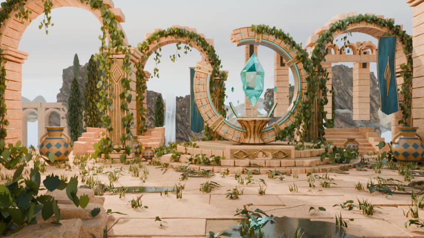
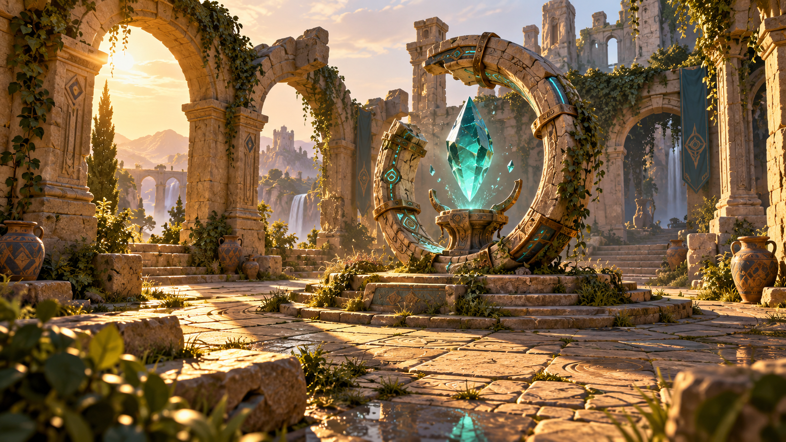

# ShowcaseScene

這是依照 `V1-Visual-Identity-Concept.png` 重建的可編輯 Blender 場景。
**目前是未完成的美術草稿，尚未達到與參考圖一模一樣。**
2026-10-12 的這次提交整理並保存目前進度，後續美術調整仍待繼續。

| 目前草稿預覽 | 目標參考圖 |
| --- | --- |
|  |  |

## 檔案

| 路徑 | 用途 |
| --- | --- |
| [ruins_scene.blend](ruins_scene.blend) | 目前重建版本，材質圖像已內嵌，可直接用 Blender 開啟 |
| [ruins_scene_preview.png](ruins_scene_preview.png) | 從搬移後場景重新渲染的 836 × 470 預覽 |
| [V1-Visual-Identity-Concept.png](V1-Visual-Identity-Concept.png) | 比對用參考圖，在場景中只作為不參與渲染的參考物件 |
| [original/ruins_scene.blend](original/ruins_scene.blend) | 搬移當時的原始草稿備份；本次可攜性驗證對象是上方的重建版本 |
| [scripts/rebuild_ruins.py](scripts/rebuild_ruins.py) | 場景重建腳本，預設使用 CPU |
| [scripts/fetch_assets.py](scripts/fetch_assets.py) | 還原重建腳本所需的固定版本素材，下載後檢查 SHA-256 |
| [scripts/validate_scene.py](scripts/validate_scene.py) | 檢查內嵌圖像、相對路徑、相機與外部 Blender library，並可重新渲染 |
| [asset-manifest.json](asset-manifest.json) | 素材來源、大小、發布者 MD5 與本機驗證的 SHA-256 |
| [ASSET_SOURCES.md](ASSET_SOURCES.md) | 素材作者及授權 |
| [evidence/validation.json](evidence/validation.json) | 本次獨立目錄重新開啟與渲染的實際結果 |

## 目前狀況

已建立石環、水晶、祭壇、拱門、階梯、陶罐、旗幟、地坪、藤蔓、地被植物、
山壁與瀑布等物件。場景保留可編輯的網格、材質、修改器、光源及相機。
本次主檔也已保存第三輪 CPU 預覽使用的石材法線修正。

仍待完成：

- 天空朝向、雲層可見度，以及夕陽逆光和霧氣的調整。
- 背景山壁、瀑布及建築的配置。
- 石材磨損、雕刻、植物、材質及光影的細部比對。
- 1672 × 941 完整解析度的最終渲染與視覺驗收。

目前預覽使用 Blender 5.1.2、Cycles CPU、32 samples 和降噪。
本機 GTX 960 2 GiB 曾發生 CUDA 渲染逾時，因此保存的場景使用 CPU；
CPU 渲染成功不代表 CUDA 相容性或即時效能已驗收。
這份離線 Blender 美術草稿尚未整合至原生 Showcase，VIS 進度維持 5/7。

## 開啟、驗證及重建

直接開啟 `ruins_scene.blend` 即可檢視場景。圖像已打包進 `.blend`，不需要先下載素材。
`original/` 只保留原始草稿，其外部資源不屬於本次可攜交付驗收。

以下命令在儲存庫根目錄執行；`blender` 需指向 Blender 5.1.2，Python 需為 3.11 或更新版本。

```powershell
blender --background --python-exit-code 1 Arts/ShowcaseScene/ruins_scene.blend --python Arts/ShowcaseScene/scripts/validate_scene.py -- --report build/showcase-scene-check.json --render build/showcase-scene-check.png
```

需要從腳本重新建立場景時，先下載固定素材。原始下載檔放在本目錄的
`assets/` 與 `textures/`，已被 Git 忽略，避免與 `.blend` 內嵌內容重複保存。

```powershell
python Arts/ShowcaseScene/scripts/fetch_assets.py
python Arts/ShowcaseScene/scripts/fetch_assets.py --verify-only
blender --background --python-exit-code 1 --python Arts/ShowcaseScene/scripts/rebuild_ruins.py -- --preview --samples 32 --device CPU --output build/ruins_scene_rebuilt.blend --render build/ruins_scene_rebuilt.png
```

取消 `--preview` 可產生 1672 × 941 渲染；這會增加渲染時間。
上述重建命令輸出到 `build/`，方便先比對目前保存的草稿。

本機 Blender 驗證詳見 [validation.json](evidence/validation.json)。
儲存庫的 Linux configure/build/ctest 由 PR 的既有 Build workflow 執行，
實際結果以該 PR 的 Checks 為準；本機 Windows 渲染不能代替 Linux 引擎驗證。
