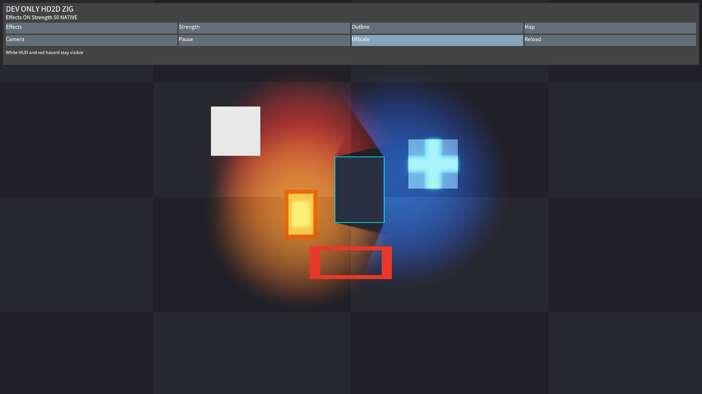
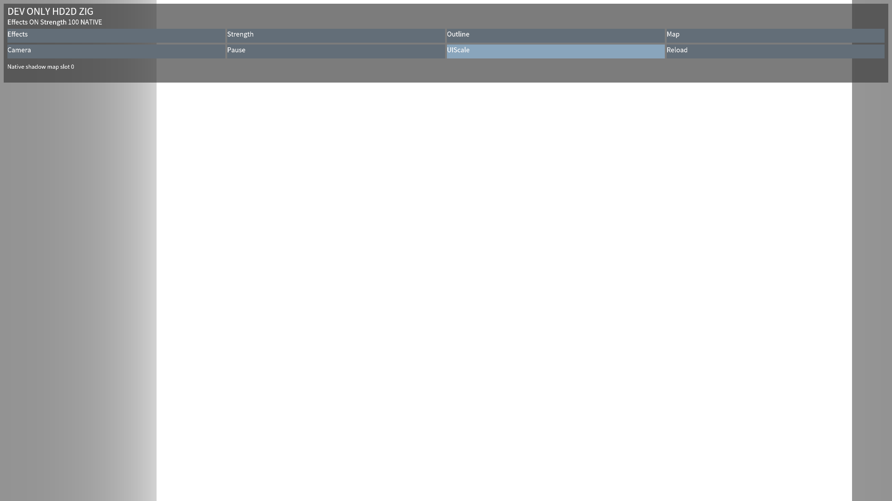

# HD2D-06: reusable Zig diagnostic and completed GPU observations

Beads `nexora-m6m.6`: ACCEPTED, PR #739 / `67db45d2`; engineering6/7.
Preparation and failed-retry history is retained below. Target-PC physical input/appearance/formal
art/performance remains NOT_RUN.

Implemented: a real Zig-owned DEV ONLY moving-lantern scene with overlapping colored point
lights, moving polygon, soft shadows, explicit emission cross, nonemissive white control,
independent red hazard and white HUD. Interactive effects/strength/contour/map/camera/pause/
UI-scale/reload controls use existing public services. The generic Player loads the actual Zig
library; there is no C++ game control implementation. The reusable binding ships test assets
with Noto OFL/NOTICE. A separate automated wrapper leaves the interactive default unchanged.

The optional effects suffix negotiates complete 40/48/56/64-byte prefixes. Diagnostics are a
copied 160-byte C/Zig structure, independently optional from pool identity and original submit.
A copied debug-view request publishes at the next frame boundary, preserves submit state and
reads the actual GPU angular map. Old hosts report Unsupported. Byte guards, wrong-thread,
provider failure/nonfinite output retention, old-host pool tails and field offsets are tested.

Eight timestamps per completed slot measure shadow/world/bloom/composite. Vulkan query pools,
DX12 queue queries/readback and Metal native counter buffers use existing completion points,
without an extra GPU wait or CPU-time substitution. Timing validity/source/status are explicit;
unavailable values are null/UNAVAILABLE. Recorded peaks are observed owned allocations and
texture counts, not physical VRAM/RSS. HUD is outside the timed effects passes.

## Retained local attempts

Raw evidence lives outside the repository in the task's stage06 directory; no raw private host
paths are published. Failed attempts remain alongside successful retries.

- `contract-build-01.log`: initial build rejected a new C diagnostics aggregate under Werror
  (missing initializers). Corrected zero initialization then explicit header fields; the second
  build passed. `contract-test-01.log`: ABI guards, effects and real Zig layout tests passed.
- `map-timing-native-01.log`: actual Vulkan presentation/readback with Khronos synchronization
  validation passed, **55 linear frames plus three legacy frames**, 40 lit / 30 shadow matrix
  frames, maxima 32 lights / eight shadowed. All four native timestamp bits were observed.
  Independent double CPU lighting/shadow/bloom oracles keep the original two-8-bit-channel
  tolerance. Added native angular-map and inactive-slot-magenta readbacks preserve safe bars
  and the separate HUD. `.bloom.ppm`, `.shadow.ppm` and `.timings.csv` retain pixels/intervals.
- The CSV includes cold software-GPU/JIT spikes; they are not removed or presented as product
  FPS. A first sample is shadow 0.614906, world 14.676731, bloom 6.471219 and composite 72.197010
  milliseconds, source Vulkan, mask 15, frame 1 / revision 100. This is not GTX 1050 Ti evidence.
- `player-headless-01.log` and `player-native-01.log`: the real Zig library completed all 12
  phases / 144 updates, two real mask/base unload/reload cycles, balanced host allocations and
  zero final asset staging/active bytes. Headless explicitly reported features 0; native
  reported features 7 and timing mask 15. Final effects-off frames retired all target/buffer/
  upload owners before teardown; re-enable/native fixture verifies fresh allocation.
- `acceptance-headless-01.log`: exported Player fallback and deterministic asset reproduction
  tests passed. Atlas source regions and linear mask use different packing widths; companion
  metadata and licensed font bytes are verified rather than generated runtime placeholders.
- `acceptance-native-01.log`: first synthetic pointer attempt failed because focus transition
  protection correctly suppressed an immediately injected press. Retain attempt-0001 logs and
  native captures. The harness now waits for a neutral focused interval before press; it still
  requires exactly one activation and an unchanged camera after the UI-scale action. No engine
  input gate, pixel assertion, tolerance, timeout or fallback behavior was weakened.
- `acceptance-native-02.log`: real native Zig Player passed **four exported/relocated cases**:
  1920x1080, 2520x1080, 800x600 and 961x541, 35.08 seconds. Actual X11 window captures contain the
  warm/cool lights, selective emitter and GPU grayscale map. Synthetic XTest input activated
  the real UI once. These are software-Vulkan/synthetic observations, not physical user input.
  Every attempt has its own directory; package inventories include both Noto notices and match
  all actual files. Validation-only 1.5-second capture holds are excluded from FPS claims.

## Final gate receipt

Full Development configure/build/CTest, Shipping configure/build, exact 18 pinned shader
artifacts and complete DX12 cross-compilation are being finalized. Windows DX12/macOS Metal
current-head native execution remains a CI gate; Linux cross-compilation is not native evidence.
DPI/coordinate admission uses the existing full display/UI matrix; physical multi-DPI window
moves/minimize and target-game acceptance remain the separate PC gate. No SP/M6/M7 historical
verdict is changed and no SDK 0.2.0 release is claimed by this stage alone.

Final Development configure/build and full CTest passed: **297 registered, 289 passed, eight
skipped, zero failed**, **112.67s**, including the real four-size Zig native suite and 55-frame
CPU-oracle native fixture. The eight skips retain held-key/optional native recording prerequisites.
`final-shader-check.log` passed exact 18 Slang artifacts. `final-dx12-cross.log` cross-compiled
the complete final fixture; it is not Windows execution. Actual scene/map captures, owned-resource
observations and completed-native-pass CSV are retained in [capture evidence](HD2D-06-Linux-captures/observations.json).

Full `linux-shipping` configure/build passed (testing intentionally disabled). Markdown routing
tests and changed-document/pair/link validation passed after supplying the pinned Markdown
parser dependency. The first standalone documentation invocation lacked that Python package;
its failure log is retained. No source/test change was needed for that tooling retry.

## Sampled-input handshake follow-up

A subsequent dependent SDK full-gate run (`stage07/final-ctest.log`, attempt-0005) exposed a
second synthetic click race: a fixed 120ms neutral interval was insufficient on a slow software
GPU frame. The actual Player completed all effects/reloads/retirement checks but the required
UI activation was absent; retain that failed full-gate XML, logs and captures.

The validation-only Zig wrapper now acknowledges two actual sampled neutral focused updates
at the intended pointer location, then acknowledges the sampled button-down after UI processing.
The harness sends press/release at those acknowledgements rather than guessing elapsed time.
Interactive gameplay and the host input lifecycle gate are unchanged. The assertion still
requires exactly one UI-scale activation with an unchanged camera, plus exactly one neutral/down
handshake. `handshake-native-repeat.log` passed three consecutive complete four-size native runs
(12 exported Player cases), retaining every attempt. No pixel tolerance or deadline changed.

The pure HD2D-06 branch then passed full Development configure/build/CTest again: **297
registered, 289 passed, eight skipped, zero failed**, **109.12s**. Shipping configure/build
passed again. `handshake-final-*` logs/XML and all native attempt directories retain this gate.

## Zig pose/snapshot alignment follow-up

Review found the diagnostic moved Sprites immediately but lights/casters publish next boundary.
It now renders the last successfully submitted pose while preparing the next light/caster pose;
the time latch also survives zero-size suspension without a mismatched restoration frame. UI
reload queues to the next update's start so it does not replace instances after pose writes.
No public ABI or host frame semantics change. Full Development configure/build/CTest passed:
297 registered / 289 pass / eight skip / zero fail, **111.82s**, including the real four-size
Zig module and native CPU pixel fixture. Shipping configure/build passed. Raw `pose-*` logs/XML
retain this gate. Native Windows/Metal final-head CI and physical acceptance remain pending.

## Native suite watchdog accounting

Independent Windows consumer job `124414329523` passed a 144-frame native run in about 53s
end-to-end, with all phases/two reloads, timing mask15/features7 and zero active/staging bytes.
The four-size suite previously had a 180s aggregate despite four independently bounded 90s
cases. Its aggregate is now 420s (four case bounds plus export/teardown). Every per-case90s,
pixel tolerance, exactly-one input and resource assertion remains unchanged. This is test
watchdog accounting, not a reduction of product FPS/performance gates or a claim of target60FPS.
Full Development configure/build/CTest passed:297 registered/289 pass/eight skip/zero fail,
**105.54s**. Shipping configure/build passed; `suite-budget-*` retains the pure-stage gate.

## First macOS configuration failure

Retain job124420121268 / run41161128001 / artifact13027828594. Native Metal55-frame independent CPU-oracle readbacks passed, with GPU timestamps explicitly unavailable on this host (seen mask0). Three new Python diagnostics were NOT_RUN failures because Python3_EXECUTABLE was empty: the older find_package block excludes Apple. Require Python Interpreter at the new registration boundary; do not add skips, alter assertions or infer actual Zig native success. Full local and native retry gates remain required.

Interpreter-scope fix local gate: full Development configure/build passed; full CTest with native Xvfb/software Vulkan and synchronization validation passed297 registered/289 passed/eight prerequisite skips/zero failures112.54s. Shipping configure/build passed. An earlier same-source gate without native tool environment passed67.82s with extra prerequisite skips; retain both and use the complete native retry for acceptance. Native macOS retry still required.

## macOS Development export boundary retry

Dependent SDK job124428232886 demonstrates that explicit Python discovery repaired test registration: asset generation passes, but both real Zig runs fail before launch because ExportGame only accepts .so/.dll and Windows/Linux dependencies. Preserve this distinct failure. Development-only Darwin export now requires .dylib, resolves actual otool imports and inherited RPATHs, copies/rewrites non-system dylibs to loader-relative names and ad-hoc signs copied Mach-O files before inventory. Editor/conflicting/missing/non-system-framework/signing failures reject publication, sources unchanged; no notarized/Shipping Mac delivery is claimed. Six portable dyld graph fixtures pass; real Mac startup remains required.

Development-only macOS export fix local gate: full Linux Development configure/build/CTest passed298 registered/290 passed/eight prerequisite skips/zero failures109.56s, including six portable dyld graph/failure fixtures and actual four-size software Vulkan diagnostic with synchronization validation. Shipping configure/build passed. Actual otool/install_name_tool/codesign and Metal Zig execution remain macOS CI gates, not claimed from Linux.

Portable dyld fixture retry: dependent macOS mimalloc job124435568972 fails with six KeyErrors because /var temporary roots canonicalize to /private/var while mocked import dictionary keys did not. An actual symlinked TMPDIR on Linux reproduced the unchanged failure (macos-fixture-alias-before.log). Resolve only the fixture root; the same six fixtures then pass under the real symlink alias (macos-fixture-alias-after.log). No exporter/runtime or assertions change; actual Mac native retry remains required.

Fixture canonicalization full local gate passed Development configure/build/CTest298 registered/290 passed/eight prerequisite skips/zero failures106.22s, actual four-size Vulkan/synchronization validation, and Shipping configure/build. Original symlink-root failure and unchanged six-fixture retry remain retained. Runtime/exporter bytes did not change.

## Accepted final-head receipt

PR #739 squash `67db45d23e631b0e05b42c23716245a34ae996d5` has the same tree as tested `05c563b845351c3253a24eae16a9564d33b43aec`. All41 final-head checks succeeded; both full Build runs41167913390/41167916242 completed successfully. Windows jobs124440345349/124440189553:430 CTests, actual55-frame CPU pixels, four-size exported Zig DX12 and timing mask15. Linux124440345361/124440189538:488 CTests,55-frame CPU pixels, four-size exported Zig Vulkan and timing15. Mac124440345367/124440189632:405 CTests, actual dyld relocation/ad-hoc signing, four-size exported Zig Metal,55-frame CPU pixels, and canonicalized six-fixture tests. The Metal CI device reports GPU timing explicitly unavailable (mask0), not fabricated zero-duration measurements. Failed interpreter/export/alias-path attempts remain above and in GitHub artifacts. This is engineering acceptance, not formal game/physical target-PC acceptance.
