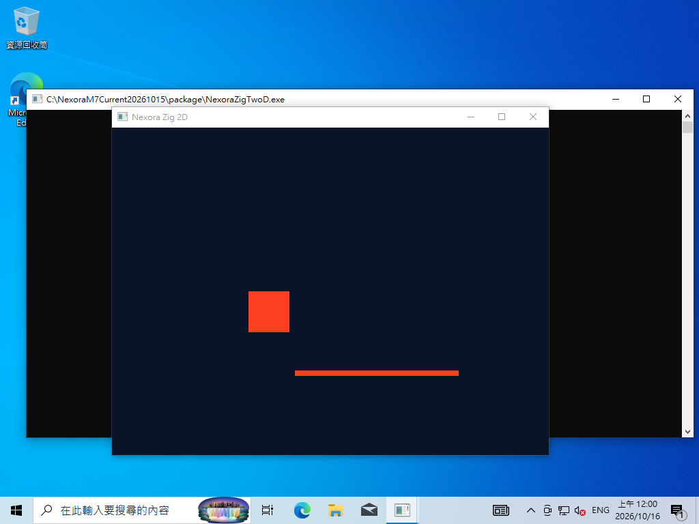
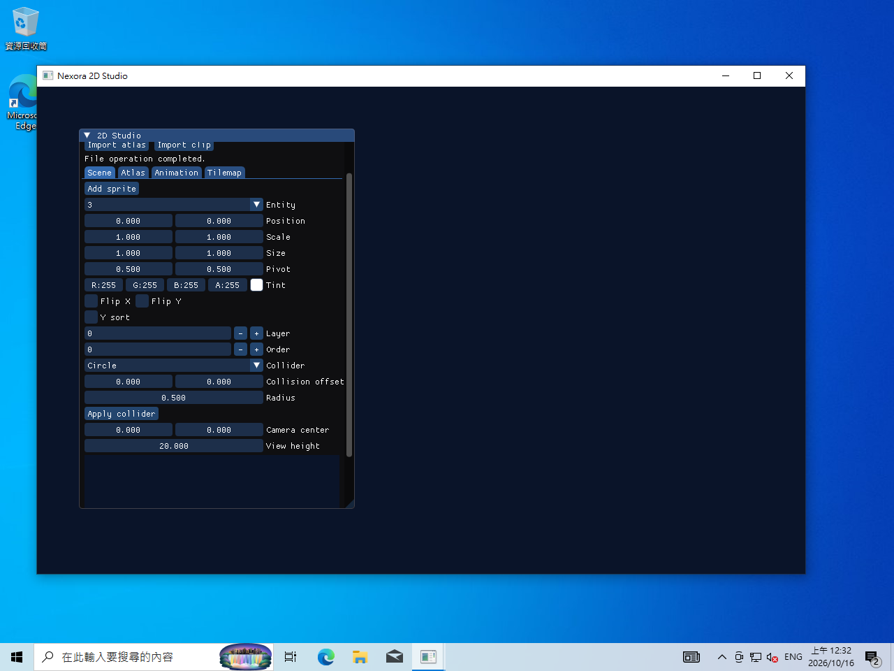

# Current-main Windows VirtualBox M7 validation — 2026-10-15–16

**Result: PARTIAL; 2D-M7 NOT ACCEPTED.** The rebuilt package passes CPU/cooked contracts,
DX12 software presentation and Zig GPU instancing in the Windows guest, including a visible desktop
window. This supersedes the older package's native failure for this new binary only. It does not
identify the earlier failure's cause, accept a hardware GPU, or complete the integrated M7 gate.
Progress remains **9/11 (82%), P0 6/8**. Beads execution is `nexora-j4q.6`; remaining product/device
integration is `nexora-j4q.7`. Parent `nexora-j4q` and physical-performance work remain open.

## Frozen build and guest

Source: `350c40eef0044c9e96607fb144a4369927b7b4f5` (main after PR #600), with no Runtime or
Renderer source changes in this run. New MSVC Monolithic Shipping Benchmark, Zig consumer and
Asset Compiler were built in an isolated checkout. Cooked assets were regenerated with that compiler.
The guest verified all four hashes (both EXEs, Atlas and Clip); exact values, configuration,
CSV rows, reports, dependency imports and the executed guest harness are in [raw-results.md](raw-results.md).
The generated manifest's `windows_clean_machine_acceptance: NOT RUN` and Zig's
`physical_windows: NOT RUN` fields are retained unchanged; this document supplies the measured VM scope.

Existing Windows 10 x64 guest `Nexora-ZS-M5-CleanMachine-Win10`, VirtualBox 7.2.20,
2 vCPUs, 6144 MiB RAM, VBoxSVGA, 3D off and 64 MiB VRAM. No snapshot was restored.
VC++ Runtime from the [previous VM run](../Windows-VirtualBox-2026-10-15/acceptance.md) was already
installed; this is a no-development-toolchain guest with that explicit prerequisite, not the original
pristine missing-Runtime baseline. No `cmake`, `cl`, `zig`, `git` or `ninja` was found on PATH;
this is not an exhaustive installed-software audit. Both EXEs import Windows/DX12 and VC++ Runtime
DLLs and no Nexora/Editor DLL. The package does not automatically install the Redistributable.
Vulkan loader remains absent; the package has Vulkan disabled. No Vulkan run or virtual-hardware
GPU acceptance is claimed. CSV device identity is **Microsoft Basic Render Driver**, vendor 5140,
device 140 (Microsoft software rendering). Audio configuration remains disabled.

## Observations

| Item | Result | Scope |
| --- | --- | --- |
| Host staging | ✅ Monolithic copy, regenerated cooked assets, hashes and corruption rejection | Independent staging before guest transfer |
| Guest hashes | ✅ All four match | Package identity/integrity |
| CPU mixed cases | ✅ Six cases, 48 measured + four warm-up frames each, exit 0 | CPU runtime and Cooked async load/reload |
| Bad cooked Atlas | ✅ Exit 1 with `invalid cooked asset` | Intended invalid-data rejection |
| Native DX12 mixed cases | ✅ Six cases, eight measured + four warm-up frames each, exit 0 | Actual guest software draw/present, load/reload |
| Zig native smoke | ✅ 120 frames, exit 0 | Instanced draws/instances, reload and allocation balance |
| Zig longer run | ✅ 1,800 frames, exit 0 | Same checks, synthetic direction input |
| Interactive desktop Zig | ✅ 1,800 frames, scheduled task result 0 and PASS report | Visible guest window plus screenshot; synthetic input |
| Human keyboard | ✅ User confirms D/W movement and Escape; 353 frames, 48 movement frames, positive entity X, task result 0, allocations balanced | Actual guest keyboard path; exits before reload |
| Studio automated smoke/reopen | ✅ 120-frame smoke and separate 12-frame read-only reopen, exit 0; document SHA unchanged by read-only process | Separate Monolithic Development authoring executable, not Shipping product acceptance |
| Studio human UI/edit | ✅ Four tabs/text/preview, Add sprite, Save/Open; changed file independently reopened unchanged | Human confirmation plus file/process evidence |
| Studio close | Original exit **1**; ✅ repaired binary exit **0**, no residual process, file unchanged | Two-line tool fix and separate fixed-binary identity; Linux close regression added |

The six mixed cases retain 100/1,000/5,000/10,000 normal objects, 1,000 overlapping objects
and 10,000 sparse objects. VM frame/GPU timings are observations, not M6 performance acceptance.
Windows `peak_process_rss_bytes=0` means unavailable, not zero memory. GPU completion lag leaves
six completed samples in each eight-frame native row. No seed, workload or performance budget was
reduced to turn a failing M6 result into a pass.

The first Guest Control native tests ran outside the interactive desktop. A temporary scheduled task
using the existing logged-in user's interactive token then ran the same Zig executable on the desktop.
The resulting report retains 1,800 instanced draws and 59,590 instances. The Zig task completed normally
and was removed. No login/password interaction or security setting change was automated.



Screenshot SHA-256: `d1574ba5caf9a48bf299d88a1184a5e540c779304f4583c171b41a551081bec5`.
This verifies visible native content, not exact pixel parity, UI text quality or physical input.

## Studio supporting evidence and startup recovery

A separate **Monolithic Development /O2** Studio was built with assertions enabled from the same
source; its hash and source Atlas/Clip hashes were verified in the guest. A subsequent two-line
Studio close fix is separately identified by base commit, exact source-file SHA-256 and EXE hash in
the fixed manifest; original and fixed binary reports are retained independently. It is not the Shipping
Benchmark/Zig package. The 120-frame synthetic smoke visits all four tabs, saves/reopens a fresh
`.nx2doc` and exits 0. A separate read-only 12-frame process reopens that file and exits 0;
the document SHA-256 remains `7c4fe0f1f47b7378978e4e781b8636b1573717899e024650399e5fa2f62ec860`.

An initial interactive launch showed a white window; an early process probe reported Responding=false.
A later pre-stop probe reported Responding=true (retained under its original diagnostic filename).
That run was stopped for an isolated retry. A bounded 120-frame desktop smoke then completed with
task result 0, and a subsequent interactive launch rendered the UI shown below. No code or graphics
driver was changed to obtain the retry; this run did not establish the startup delay's root cause.
Guest resolution changed from 1024x768 to 1280x960 to fit the 1100x800 Studio window. Resolution change
is not a display-DPI transition test. A transient 0-bit framebuffer capture error after GUI attachment
cleared after an explicit 32-bit mode hint. The initial internal ImGui panel is narrow and can be
resized by its lower-right grip. The user expanded it and confirmed all four tabs, text/preview and
Add sprite / Save / Open. The screenshot records the original binary after that successful manual edit.



Studio screenshot SHA-256: `a9d4213f31a2d0139fa9f3c3144d1e3c3d495620785cd78ffcdb1ddcbe80f151`.

Studio build commands:

```powershell
cmake --preset windows-showcase-development -G "Visual Studio 17 2022" -A x64 -DCMAKE_CONFIGURATION_TYPES=Development -DNEXORA_BUILD_SHOWCASE=OFF -DNEXORA_ENABLE_2D=ON -DNEXORA_ENABLE_EDITOR_GRAPHICAL_SHELL=ON -DNEXORA_ENABLE_VULKAN_BACKEND=OFF -DNEXORA_ZIG_EXECUTABLE=<repository-pinned-zig.exe> -DCMAKE_CXX_FLAGS_DEVELOPMENT=/O2 -DCMAKE_C_FLAGS_DEVELOPMENT=/O2 -DNEXORA_LINK_MODE=Monolithic
cmake --build --preset windows-showcase-development --target NexoraTwoDStudio --parallel 2
NexoraTwoDStudio.exe --workspace <fresh-workspace> --atlas atlas.nx2atlas --clip clip.nx2clip --document scene.nx2doc --smoke --frames 120
NexoraTwoDStudio.exe --workspace <same-workspace> --atlas atlas.nx2atlas --clip clip.nx2clip --document scene.nx2doc --read-only --frames 12
```

## Observed close failure and verified repair

The human-edited document changed to SHA-256
`45cd40aad07c210d5f153e423511920453e6ecfa527fa0d9ad6ec58eea42c13f`.
A separate read-only process reopened it successfully and left that hash unchanged. The original
interactive Studio then closed visibly but its scheduled-task result was **1**, so original normal
shutdown was **FAILED**, regardless of the positive human UI report. The earlier `studio-final-result`
snapshot was taken before that close and therefore still says Running; the later `studio-exit` records 1.

`BeginFrame()` pumps the native close event and returns `SurfaceLost` with `CloseRequested()==true`.
Studio validated acquisition before rechecking that flag, throwing `acquire` instead of leaving the
loop. The tool now checks close immediately after the pump, then follows its existing draw/texture
validation and `DrainAndDestroy()` path. Unrelated acquisition/render/present failures still fail.
Runtime/Renderer and the Shipping Benchmark/Zig binaries are unchanged by this repair.

✅ The rebuilt, separately hashed Studio passes another independent read-only reopen and preserves
the edited hash. The user closes the repaired desktop window; scheduled-task result is **0**, no
Studio process remains, and the document hash is unchanged. This accepts the repaired tool close
path, not the complete integrated Shipping product lifecycle. The fixed manifest identifies Studio.cpp
SHA-256 `0b1af2f054ba83ee1550c93859a1a451478e23b94eef2e2574bbb22290b3fe9e` and the new EXE.

The existing Linux `twod.cloud_native` regression now starts unbounded Studio, waits for visible
rendered UI, sends a real `WM_DELETE_WINDOW`, and requires exit 0 plus the completed native/document
lifecycle message. It reuses the existing X11 close/capture helper and retains the pre-close screenshot
and output log. Full Linux configure/build/CTest validation runs in the PR CI; none is claimed on this
Windows build host. Python syntax/import/argument parsing and local documentation checks pass.

## Commands

On the Windows build host (Visual Studio 2022 CMake/MSVC, repository-pinned Zig 0.14.0):

```powershell
cmake --preset windows-showcase-shipping -G "Visual Studio 17 2022" -A x64 -DCMAKE_CONFIGURATION_TYPES=Shipping -DNEXORA_BUILD_SHOWCASE=OFF -DNEXORA_ENABLE_2D=ON -DNEXORA_ENABLE_EDITOR_GRAPHICAL_SHELL=OFF -DNEXORA_ENABLE_VULKAN_BACKEND=OFF -DNEXORA_ZIG_EXECUTABLE=<repository-pinned-zig.exe>
cmake --build --preset windows-showcase-shipping --target NexoraTwoDBenchmark NexoraZigTwoD NexoraTwoDAssetCompiler --parallel 2
python Tools/TwoD/StageValidation.py --runtime <shipping-benchmark.exe> --compiler <shipping-asset-compiler.exe> --atlas <source-atlas.nx2atlas> --clip <source-clip.nx2clip> --output <fresh-package>
```

The manifest additionally hashes the separately copied Shipping Zig EXE. Transfer uses VirtualBox
Guest Control with the existing guest account and credential file; no credentials are published.
The guest harness clears PATH to Windows system directories and retains stdout/stderr, bounded waits,
actual exits, hashes and CSV. Equivalent application commands from the copied package directory:

```powershell
./NexoraTwoDBenchmark.exe --atlas assets/atlas.nxcook --clip assets/clip.nxcook --frames 48 --report <cpu.csv>
./NexoraTwoDBenchmark.exe --atlas <corrupt.nxcook> --frames 4 --report <corrupt.csv>
./NexoraTwoDBenchmark.exe --native --atlas assets/atlas.nxcook --clip assets/clip.nxcook --frames 8 --report <native.csv>
./NexoraZigTwoD.exe --native --frames 120 --report <zig-native.json>
./NexoraZigTwoD.exe --native --frames 1800 --report <zig-desktop.json>
```

Initial host configuration attempts incorrectly enabled Studio in Shipping (Shipping deliberately
forces Editor off), then exposed a Visual Studio configuration cache missing Shipping; neither was
counted as a successful build. The final explicit configuration above built all requested targets.
The guest disallowed loading a `.ps1` file under its existing policy; the harness ran as an inline
command through Guest Control. Execution policy was not changed. Computer Use initialization and
reset/retry failed with Windows sandbox `helper_unknown_error: setup refresh had errors`; automated
UI input is not inferred from it. Actual keyboard and Studio UI actions were performed and confirmed
by the human, with independent program/file/exit checks above. VirtualBox CLI launches, reports and guest framebuffer capture remained usable.

## Remaining M7 gates

Controller routing, integrated product UI/text, audible device output, display/DPI changes
and one standalone cooked product's complete save/reopen/ordered teardown remain unaccepted.
Benchmark/Zig tools do not invoke audible playback; Runtime's [AudioEngine contract](../../../Runtime/README.md)
explicitly performs no device I/O. Merely enabling VM sound or hearing an OS sound cannot accept
engine audio. The separate Studio smoke, human edit and repaired close are supporting authoring evidence, not an
integrated Shipping product gate. `nexora-j4q.7` tracks the remaining integration and device acceptance flow.

All temporary acceptance scheduled tasks were removed (the guest query returned an empty array).
The original 1024x768 display resolution was restored, then ACPI graceful shutdown completed;
VirtualBox verified **poweroff**, 3D off/64 MiB and audio disabled. Guest test files and the previously
installed VC++ Runtime remain for reproducibility. No snapshot was restored or guest driver installed.

No whole M7 checkbox is marked complete. M6 physical minimum-spec budgets remain independent.

## 繁體中文摘要

**本次重建版本在 Windows VM 的 CPU／Cooked／DX12 軟體呈現／Zig Instancing 已通過，M7 仍為部分驗收。**
客體核對四個雜湊一致；損毀 Atlas 正確拒絕。桌面可見的 Zig 視窗完成 1,800 幀、正常退出，
保留畫面、reload、Instancing 與配置平衡證據。這次使用 Microsoft 軟體 renderer，不能代替
實體 GPU／最低 PC 效能驗收。舊封裝的原生失敗不再重現，但沒有宣稱已定位或修復其根因。
使用者已確認 D／W 鍵盤移動及 Esc 正常，報告有 48 個移動幀且正常退出。手把、可聽引擎音訊、
整合產品 UI／文字、DPI 與完整 Shipping 產品生命週期仍待驗收；
音訊裝置輸出亦不是目前兩個驗證程式提供的功能。Studio 四分頁／文字／預覽與 Add sprite → Save → Open
已由使用者確認，獨立程序重開並保持新雜湊。原版按 X 退出碼為 1；已修正事件泵送後的關閉判斷，
修正版由使用者再按 X，確認退出碼 0、無殘留程序且存檔不變，並補 Linux 原生關閉回歸測試。
進度保持 9/11（82%）、P0 6/8。
