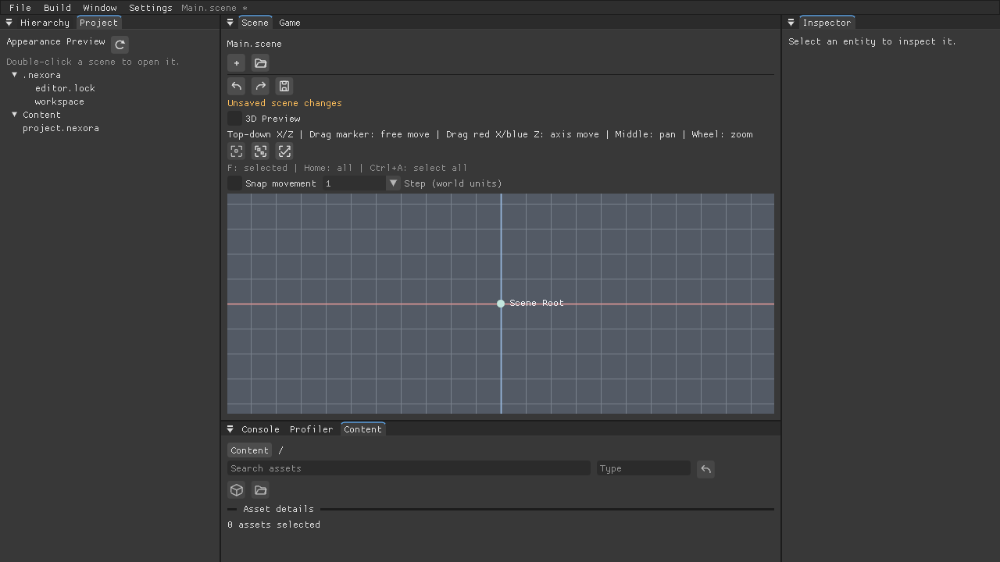
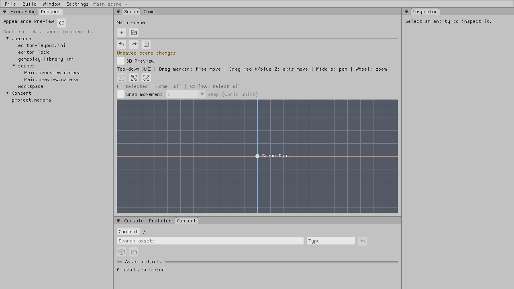

# Editor light and dark appearance — Linux, 2026-10-31

The Editor now exposes **Settings > Appearance > Dark / Light**. Both are editor-owned,
Unity-inspired neutral palettes with blue selection/focus accents. Dark remains the default.
This accepts the bounded appearance feature, not an entire Editor milestone or physical-host gate.

## Behavior and ownership

- The UI emits an owning theme request; the application consumes it once after EndFrame, applies
  the palette between frames and persists explicit selections outside project-owned files.
- `appearance` is stored beside the user recent-project list (including a configured
  `--recent-projects` path). It uses `schema=1` and `theme=dark` / `theme=light`, bounded to 64 bytes.
  Missing files select Dark without creating files; malformed/oversized/symlink reads do not write.
  Explicit selection can replace a corrupt record. An occupied atomic staging path preserves the
  good file. A failed save retains the session theme and exposes a retryable Appearance warning.
- Project layout loading, project switches, read-only access and DPI changes retain the user theme.
  Theme changes preserve panel geometry and font scale; Scene/Game and authored material colors
  are unchanged. Icons inherit text color. Status and Transform axis colors adapt to the palette.
- The display-referred palette decodes once to RenderUi's linear vertex colors, allowing native
  sRGB output to show the intended dark panel gray near 56 and light gray near 194. This avoids
  unintentionally brightening the swatches. No renderer contract or shader changed.
- New C++ interfaces are additive: `EditorColorTheme`, preference load/save, and the UI's theme
  setter/getter/request consumer. Gameplay C ABI and scene/project formats are unchanged.

## Verified cases

`editor.appearance_1x` and `editor.appearance_2x` pass. Actual menu pointer events request both
choices; requests are consumed once and do not apply mid-frame. Tests cover preference round-trip,
LF/CRLF, malformed/oversized/invalid-enum/empty-path rejection, occupied staging preservation,
recreated-host restore, layout independence and DPI geometry. Opaque text/icon contrast is at
least 4.5:1 on standard panel/input/button/selection/popup backgrounds; semantic axis/status
colors are at least 3:1 against the panel surface. This does not claim full accessibility acceptance.

`editor.linux_appearance` passes with actual X11/Vulkan software rendering. It observes presented
panel pixels, clicks the real menu, checks disk bytes, reopens with the saved Light preference,
then switches back to Dark in a read-only project. Both windows close through the real unsaved-scene
discard prompt; authored project descriptor/scene content remains unchanged. The fixture uses
current-schema project data so legacy migration is not mistaken for an appearance write.

## Commands and environment

System headers, Clang 19, Xvfb/xdotool and software Vulkan dependencies were restored from
SHA-verified official Debian packages into a task-local sysroot. The existing configured Slang
2026.18 was restored outside the repository. No dependency versions, CI or local paths were
committed. GUI and 2D support are enabled in the development cache.

```bash
cmake --preset linux-development
cmake --build --preset linux-development -j 5
ctest --preset linux-development -j 3 --output-on-failure
ctest --preset linux-development -R '^editor\.(appearance_[12]x|linux_appearance)$' --output-on-failure
cmake --preset linux-shipping -DNEXORA_ENABLE_SLANG=OFF
cmake --build --preset linux-shipping -j 3
python3 -m unittest discover -s Tools/Build -p TestDocumentationCI.py
```

The appearance-specific traversal passes 3/3. Shipping configure and the 111-action Monolithic
Minimal build pass; that profile strips Editor and testing, so this is the required linkage/profile
gate, not native Editor coverage. Development supplies the separate Editor coverage.

## Full-gate result

The complete development traversal registered 414 cases: 408 passed, zero skipped, and six needed
follow-up. Five were the old blue-control fixture assumptions described below; the separate Xvfb
negative-control readiness case passed on isolated recheck without source changes. After the fixture
updates, a single final traversal of all six resolved cases passed 6/6 in 33.95 seconds. Aggregate
coverage is 414 unique passing cases, zero skips and zero unresolved failures. This does not claim
that the original full traversal was failure-free.

The full traversal took 802.23 seconds. Development configure/build, the Shipping gate, all three
appearance cases, documentation tests 16/16, changed Markdown links/bilingual counterpart checks,
formatting of all eight touched C++ files, three Python syntax checks and `git diff --check` pass.
The root README is unchanged because no overall milestone moved.

## Native fixture compatibility

The existing reflected Inspector/array and Prefab native fixtures assumed a blue fill for every
control. They now require presented surface/contrasting artwork and the default Dark neutral
hover/held/released swatches. Physical press/release acknowledgements, caret/draft pixels, exact
saved payloads, read-only preservation, selected revert, source publication and Undo/Redo remain
required. Five affected native workflows pass after updating those expectations: reflected
Inspector, reflected arrays, placement overrides, selected revert and instance source apply.

## Native screenshots

Captured from the real Editor window in Xvfb with the same software Vulkan backend. They show the
initial workspace in the two saved palettes; English labels and the built-in font were used.
Physical display, Windows/macOS color/DPI and assistive-technology acceptance remain separate.




