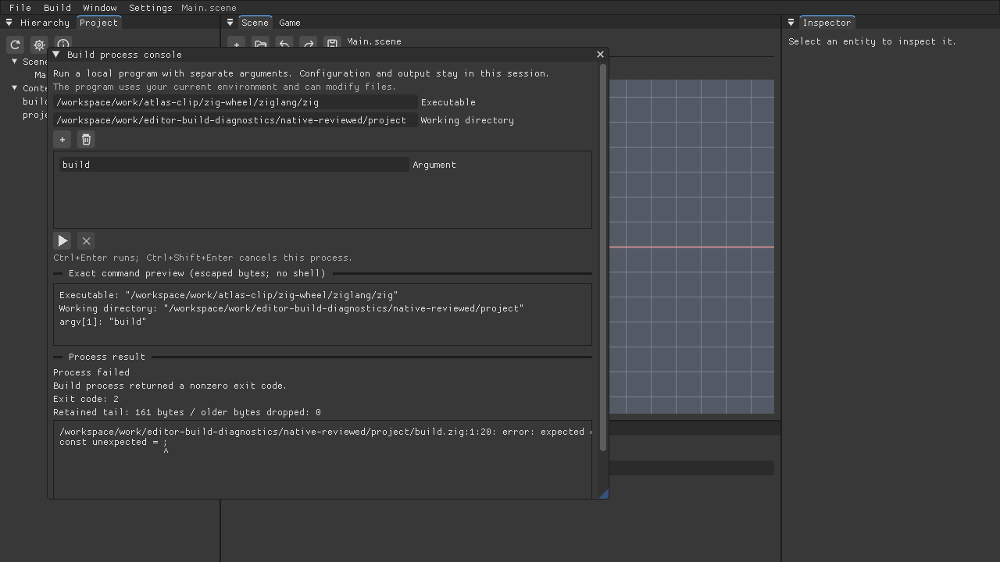
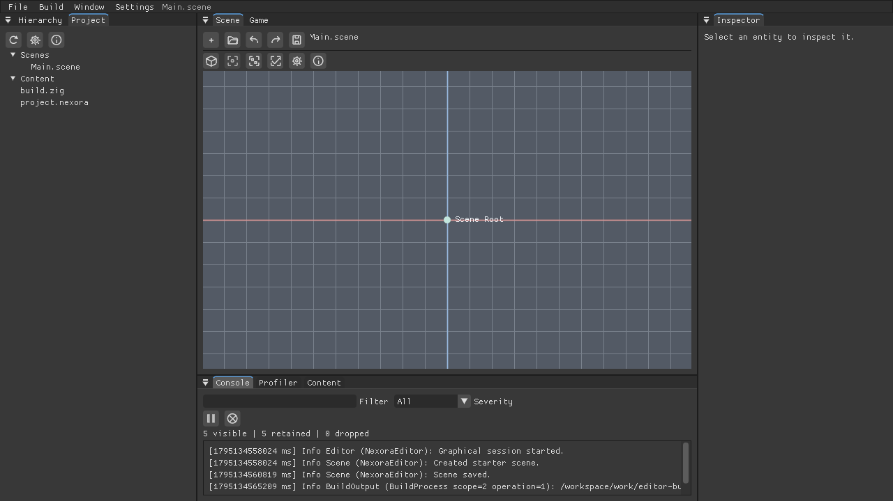
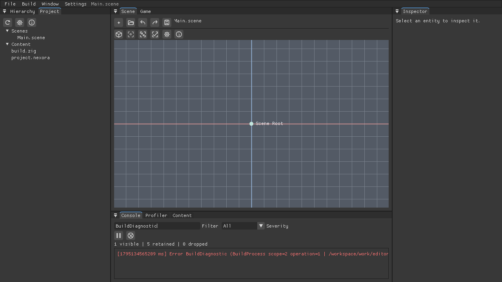

# ✅ Compiler diagnostic projection — Linux qualification

Complete Linux configure/build/unfiltered CTest qualification passes **564/564 in 6022.40 s**,
zero failures/skips/retries. This supporting slice
belongs to `nexora-gu7.14.1`; it does not complete M3-06 or change whole-milestone counts.
[Machine-readable receipt](Build-Diagnostics-Linux.json) records the frozen implementation hashes.

The private owner converts complete plain-text Zig/Clang `path:line:column` error/warning/note
lines into owning Runtime Console severity/location records alongside unchanged raw BuildOutput.
16 KiB raw/poll, 4096-byte partial lines and 64 diagnostic admissions/poll bound the projection.
Missing raw bytes, discarded oversized lines and known suppressed diagnostic records retain
separate units. Scope/operation changes and gaps cannot splice partial lines; terminal tails
flush once. Other compiler syntaxes, ANSI output and multiline contexts remain raw text.
The first severity marker delimits the location; paths containing such markers are outside the
supported projection. Coordinates must be positive 32-bit decimal values. Locations are text
provenance; there is no file navigation or artifact-success authority.

Focused raw/derived adapter tests pass **2/2 (0.05 s)** after the final C++ changes, covering every
byte split, UTF-8/Windows paths, CRLF, terminal tails, exact line/source limits, gaps, oversized
lines, suppression/admission, stale/regressed/invalid snapshots and original-byte conservation.
Documentation helper tests pass **16/16**; final document-link validation is recorded with delivery.

The real native Xvfb/Vulkan Editor ran Zig **0.14.0** using its actual executable/argv controls:
`zig build` on an intentionally invalid `build.zig`. The process really failed with code **2**;
Console owns an **Error** at `build.zig:1:20` with message `expected expression, found ';'`, while
original ASCII-escaped **Info BuildOutput** retains the diagnostic/context bytes. Artifact status
remains unverified. Editor closes normally with code **0**, without Vulkan validation errors;
project, saved scene and Zig source SHA256 remain unchanged. A real Console-tab/filter gesture
exposes the red derived row. Full location/message bytes are retained in the receipt even where
the default narrow Console clips their display. No test helper injects a process outcome or a
Console record. The evidence observer is compile-time test gated and explicitly environment enabled.
Initial fixture-authoring failures were retained externally and corrected before this accepted cohort.





Native command (using the recorded Linux tool environment):

```bash
python3 Tests/EditorImGui/LinuxBuildDiagnostics.py \
  --editor build/linux-development/Apps/Editor/NexoraEditor \
  --zig /workspace/work/atlas-clip/zig/zig \
  --xvfb /workspace/work/atlas-clip/toolchain/usr/bin/Xvfb \
  --xdotool /workspace/work/atlas-clip/toolchain/usr/bin/xdotool \
  --evidence /workspace/work/editor-build-diagnostics/native-reviewed
```

No module graph, public ABI, production linkage boundary or routine CI trigger changes.
Windows/macOS/mobile and physical desktop acceptance are not claimed. Full runtime/build
producer coverage and debugger integration remain open.
