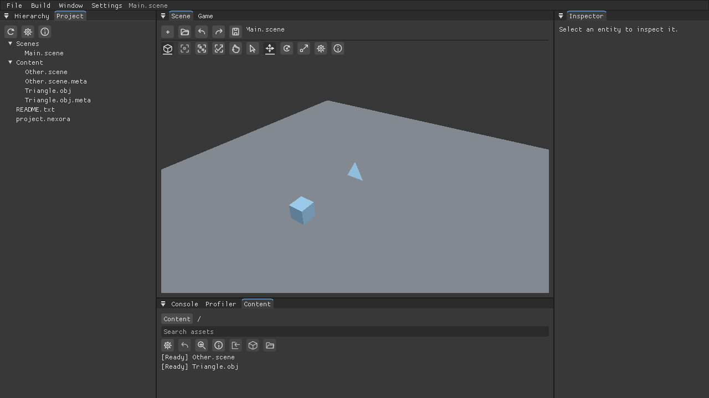
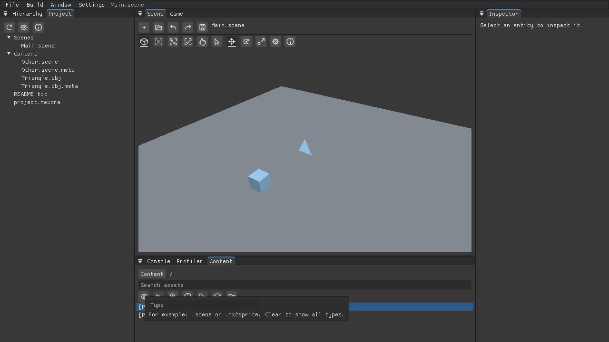
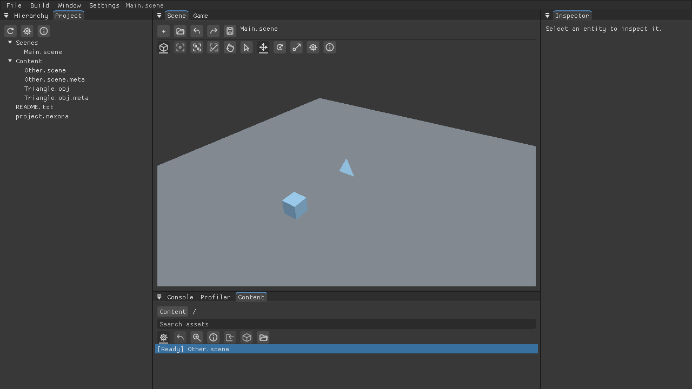
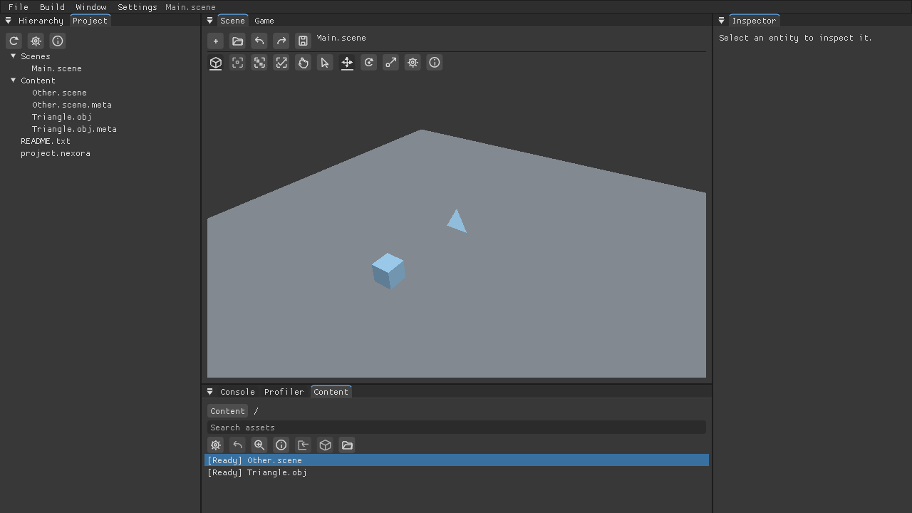
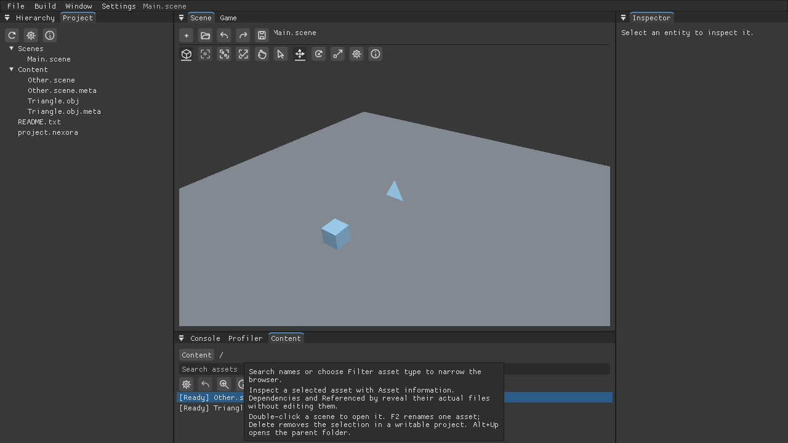
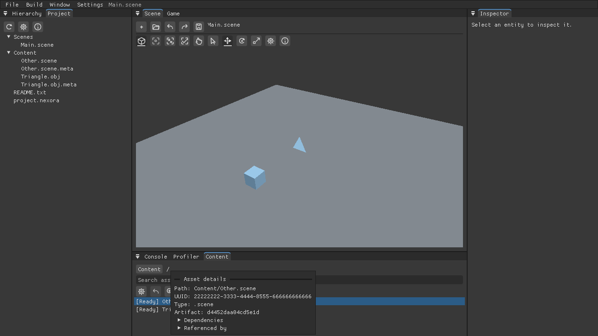

# ✅ Compact Content controls — Linux qualification

Content uses dock-width search and wrapping Filter/Undo/Asset information/Help/Import details icons.
Asset paths, UUIDs, artifacts and forward/reverse references appear on demand. Active imports,
cancellation and actionable diagnostics stay directly visible. Inspection does not edit assets;
Reveal revalidates current root/generation/revision and consumes its UUID after borrowed rows finish.
One owning import snapshot is taken per GUI frame after polling.

Final-head review of `4b8ef11` exposed popup Enter/F2 leaking to Open/Rename. Actual key input
reproduces both on that source. One shared popup guard now protects navigation, Enter and F2;
actual 1x/2x writer/read-only checks verify blocked popup shortcuts and restored normal shortcuts
after closing inspection, with source bytes, scene, history, revision and selection preserved.
The original 562/562 (6538.33 s) cohort remains archived and does not qualify the corrected inputs.

Corrected actual-widget validation passes **3/3 in 21.97 s**, including actual 1x/2x interaction,
150-unit docks, read-only type filtering, dependency Reveal, keyboard ownership, stale/root scope,
modal blocking, unchanged authored bytes and history. Earlier failed fixture attempts are retained
as non-acceptance. The complete Linux configure/build/unfiltered CTest gate passes **562/562 in 6046.70 s**,
zero failures/skips/retries.
Final-head review and own-PR merge remain required.

The actual 1280×720 Vulkan Editor displays asset information, filters `.scene`, clears filtering,
opens help and double-clicks `Content/Other.scene`. The rendered title and exact persisted scene
session acknowledge that path. It closes normally with exit0; all eight authored-file hashes and
five code-input hashes remain unchanged. Help/information Enter phases are acknowledged; Enter/F2
leave the exact scene session unchanged and do not acquire a Rename text owner. The scene-request debug counter is not used as proof.
See the [structured receipt](Content-Controls-Linux.json).

This presentation-only slice changes no production module linkage or public ABI. The test executable
uses the existing Dear ImGui test dependency; a Shipping linkage gate is not applicable.
Workflow **6/9**, graphical Editor **0/8** and TwoD **9/11** remain unchanged. Parent8.3/ED-WF-08,
independent8.2/ED-WF-05 and platform/clean-host gates retain their separate acceptance requirements.
