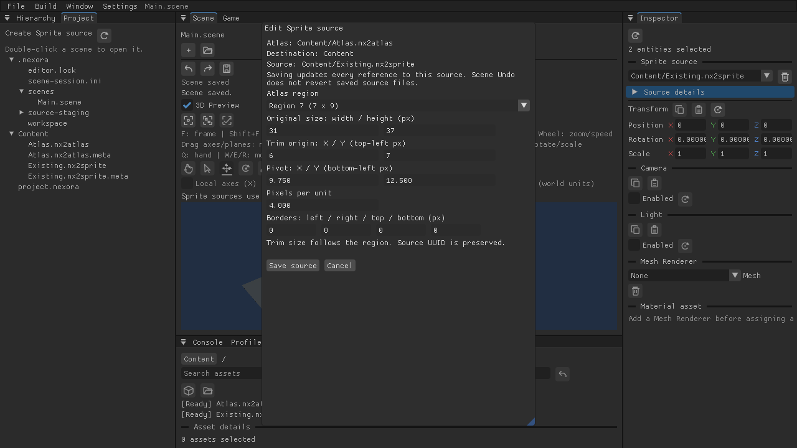
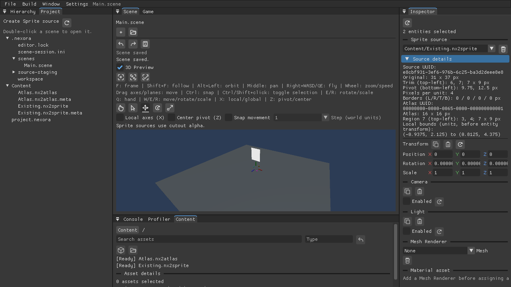
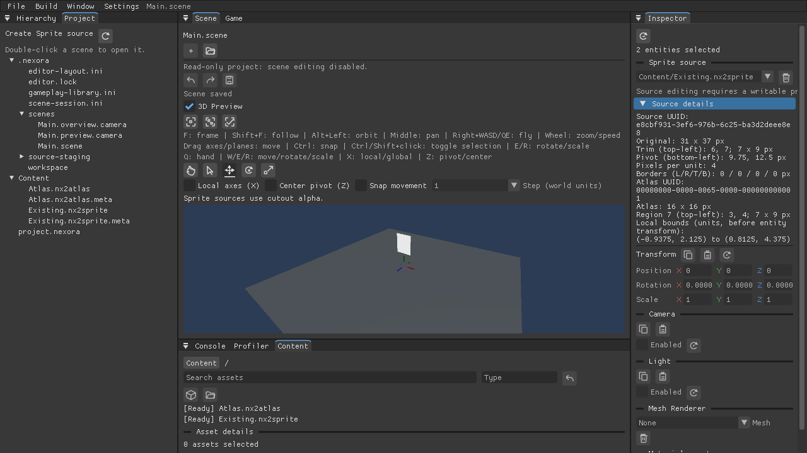

# Main Editor existing Sprite source editing — Linux Cloud, 2026-11-15

This supporting `nexora-whr.7.12` slice starts from main `5e284c6e1c0295e8559b20496575f3f00d002cd6`. The main Content menu edits an existing imported Sprite source through owning actual controls, preserves its path/UUID/sidecar, and publishes normal typed immutable metadata after a staged single-file replacement.

The shared validator covers stable same-Atlas regions, original dimensions, top-left Trim, bottom-left pixel Pivot, PPU and border metadata. Borders require a full untrimmed canvas; sliced rendering remains open. Source edits affect main-scene references but do not change Scene/Runtime bytes or add Scene Undo. Current Content selection/view and file-move Undo survive, including the edited metadata in retained Undo rows.

## Acceptance

- Model and actual 1x/2x widgets cover owning one-shot requests, normal save/retry/cancel, stable identity, immutable old owners, portable names/paths, stale imported/disk baselines, bad identity keys, supported CRLF/type-value casing, ordinary sole-link files, directory/file aliases, recovery/read-only/busy/Play/focus admission and transient focus-loss revocation.
- The source and mandatory sidecar are checked again at replacement. Atlas IDs/UUIDs cannot change. Normal import, browser/Undo budgets and dependency candidates are prepared before publication. Same-parent exclusively owned staging uses an ignored metadata suffix. Only owned staging entries are cleaned up.
- Native X11 creates an initial source using the real dialog, assigns its UUID to two actual entities, saves the Scene, edits through the real dialog, and independently decodes the resulting 96-byte source. Old-only and shared world-space pixel probes verify the new quad under the unchanged camera. Inspector metadata updates immediately; cancel and byte-identical read-only reopen pass. No source bytes are patched to manufacture a successful edit.
- Project/Content versions and caller authority are owning-call guards, not capabilities carried by GUI requests. No GUI file IO, Atlas/image read, full project scan, native resource registration, C/Zig/table/schema change or running-Play mutation is introduced.
- This is a cooperative local-filesystem operation, not adversarial compare-and-swap, multi-file snapshot or power-loss durability. Native replacement errors remain Uncertain; successfully replaced files are never relabeled Rejected by postcommit allocation.

## Latest-main integration validation

Before merge, all **41/41** hosted checks succeeded on original head `4c282fd4415d888c6d5fe8c6a0ee2526e1c0eaa3`.
Final verification then found main advanced to `0c0a8953ed916ef995920308b90c6cb9e54a1635` (PR #793), overlapping the
Editor/Play paths. The PR returned to draft; the clean combined tree was revalidated instead of
merging against an untested base. Original successful receipts below remain historical.

Fresh complete Linux: **528/528**, zero failures/skips, **2212.45 s**. This includes
the real source-editing case and PR #793's actual configured source/Atlas reimport case. Shipping
Full, actual TwoD-OFF/testing-OFF Editor/native Player, graphical Monolithic source and Play CPU
tests, real Monolithic source editing, and documentation utilities also pass. The integrated model
fixture already contains the distinct uppercase-extension basename; there is no post-gate source
edit. All frozen integrated source hashes remain exact. Fresh exact-head hosted CI is required
before delivery; old green checks are not substituted. No remote workflow was canceled/retried.

- `cmake --preset linux-development`: exit 0, 2.22 s; log SHA256 `9bc57e153e4ab022b6e6b28c1974692b79db3e720fb51c06d3a7a148b097a126`.
- `cmake --build --preset linux-development`: exit 0, 120.25 s; log SHA256 `a4cb1c0733860b8832fe9635ade07f5dd15d938b4aa56c86649d35fdfb59fad3`.
- `ctest --preset linux-development --show-only=json-v1`: exit 0, 0.12 s; log SHA256 `42246d28dd6e373b3c0342bbcfef6f17952d88f85d02a0f88daf90520bfd101a`.
- `CTEST_PARALLEL_LEVEL=2 ctest --preset linux-development`: exit 0, 2212.56 s; log SHA256 `96317a3ba105bbc7e8f87bf58210fdba645b6e720caac5be65eb064a24690c40`.
- `cmake --preset linux-shipping -DNEXORA_SHIPPING_PROFILE=Full -DNEXORA_ENABLE_EDITOR_SDK=ON`: exit 0, 0.62 s; log SHA256 `48171b65944bf5caee46dfd3d66081c4c121b180cd226883ac7bc2ed01988672`.
- `cmake --build --preset linux-shipping`: exit 0, 14.91 s; log SHA256 `e64fe60070942fcfeb327fd0a79dba490548e334ab532118496c5a991f62ccfa`.
- `cmake --preset linux-development -B build/editor-no-tests -DBUILD_TESTING=OFF -DNEXORA_ENABLE_2D=OFF -DNEXORA_ENABLE_EDITOR_GRAPHICAL_SHELL=ON -DNEXORA_BUILD_PROJECT_PLAYER=ON -DNEXORA_ENABLE_PROJECT_PLAYER_NATIVE=ON`: exit 0, 0.45 s; log SHA256 `ea90c834b0415c0601695cc8a12d67111b5333fb5e323c546cfa9ca7ebe556e5`.
- `cmake --build build/editor-no-tests --target NexoraEditor NexoraProjectPlayer`: exit 0, 16.12 s; log SHA256 `6921bc64343312463cc5f0d1ea907e97007e157b38795f801ee233d211aad53c`.
- `cmake --preset linux-development -B /workspace/work/editor-completion/packaged-preview-monolithic -DNEXORA_LINK_MODE=Monolithic -DNEXORA_ENABLE_EDITOR=ON -DNEXORA_ENABLE_2D=ON -DNEXORA_ENABLE_WINDOW_PRESENTATION=ON -DNEXORA_ENABLE_EDITOR_GRAPHICAL_SHELL=ON -DNEXORA_ENABLE_ZIG_GAMEPLAY=OFF -DNEXORA_ENABLE_SLANG=ON`: exit 0, 1.77 s; log SHA256 `813b3df538d06a8c2026cc9b638201f81dfffe244c0cba03489b94966e2b8cb4`.
- `cmake --build /workspace/work/editor-completion/packaged-preview-monolithic --target NexoraEditor NexoraSpriteSourceCreationTests NexoraSpriteSourceEditingTests NexoraSpriteSourceCreationUiTests NexoraGameSpriteSessionTests NexoraPackagedSpritePlayTests NexoraGameSpriteBuildTests`: exit 0, 25.04 s; log SHA256 `9d19bcd1a8172cb06ffb61526e3438da3f591e1c94857541340b1fec56100e60`.
- `ctest --test-dir /workspace/work/editor-completion/packaged-preview-monolithic -R '^(editor.sprite_source_(creation|editing|creation_ui)|twod.game_sprite_session|editor.packaged_sprite_play|editor.game_sprite_build)$' --output-on-failure`: exit 0, 2.57 s; log SHA256 `0efad6d394356ad1f11398b48e17fdb642c90317b43073c94340757e34655ab6`.
- `python /workspace/Nexora/Tests/EditorImGui/LinuxSpriteSourceEditing.py --editor /workspace/work/editor-completion/packaged-preview-monolithic/Apps/Editor/NexoraEditor --fixture /workspace/work/editor-completion/packaged-preview-monolithic/Tests/EditorImGui/NexoraSpriteSourceCreationUiTests --xvfb /workspace/work/editor-completion/sysroot/usr/bin/Xvfb --xdotool /workspace/work/editor-completion/sysroot/usr/bin/xdotool`: exit 0, 90.22 s; log SHA256 `fa4d39f0e0c1e61a8b3dd39f2930a325e3af103d136e126232cd6c0624ad282c`.
- `python Tools/Build/TestDocumentationCI.py`: exit 0, 0.65 s; log SHA256 `76d453ef3fbc7a2e09000d2ebcaf17ec121f82346b769c0802b6409ef0a2ef0c`.

## Original-base validation

Complete Linux: **527/527**, zero failures/skips, **1895.68 s**. Shipping Full, actual TwoD-OFF/testing-OFF graphical Editor/native Player, and graphical Monolithic model/controls plus real native Scene-pixel editing all pass. Documentation utilities pass independently. Windows/macOS hosted CI is required before delivery; no local Windows/macOS execution is claimed.

- `cmake --preset linux-development`: exit 0, 2.11 s; log SHA256 `9bc57e153e4ab022b6e6b28c1974692b79db3e720fb51c06d3a7a148b097a126`.
- `cmake --build --preset linux-development`: exit 0, 61.84 s; log SHA256 `4dcc619efe013607ab71bf42a50de5950d14be322f9701a4edec25743868dacd`.
- `ctest --preset linux-development --show-only=json-v1`: exit 0, 0.12 s; log SHA256 `5512954bfd161fb5c9629f766e11c0ffbc972f0cd25260129e59988ae1c4e92c`.
- `CTEST_PARALLEL_LEVEL=2 ctest --preset linux-development`: exit 0, 1895.78 s; log SHA256 `0935cb7946d96fee34cb5041cc8f62caf227b52cec78bbe4d39a5dd0fcc349a5`.
- `cmake --preset linux-shipping -DNEXORA_SHIPPING_PROFILE=Full -DNEXORA_ENABLE_EDITOR_SDK=ON`: exit 0, 0.68 s; log SHA256 `48171b65944bf5caee46dfd3d66081c4c121b180cd226883ac7bc2ed01988672`.
- `cmake --build --preset linux-shipping`: exit 0, 26.45 s; log SHA256 `4b89e03caa40016f4b7f8022e395b5632e454306bedca31f4ced925c6764aca4`.
- `cmake --preset linux-development -B build/editor-no-tests -DBUILD_TESTING=OFF -DNEXORA_ENABLE_2D=OFF -DNEXORA_ENABLE_EDITOR_GRAPHICAL_SHELL=ON -DNEXORA_BUILD_PROJECT_PLAYER=ON -DNEXORA_ENABLE_PROJECT_PLAYER_NATIVE=ON`: exit 0, 0.45 s; log SHA256 `ea90c834b0415c0601695cc8a12d67111b5333fb5e323c546cfa9ca7ebe556e5`.
- `cmake --build build/editor-no-tests --target NexoraEditor NexoraProjectPlayer`: exit 0, 18.43 s; log SHA256 `f96d6891f7f47f9d92fb97ec68fb975a6ce62106d71536ddaf8b0ebe643df284`.
- `cmake --preset linux-development -B /workspace/work/editor-completion/packaged-preview-monolithic -DNEXORA_LINK_MODE=Monolithic -DNEXORA_ENABLE_EDITOR=ON -DNEXORA_ENABLE_2D=ON -DNEXORA_ENABLE_WINDOW_PRESENTATION=ON -DNEXORA_ENABLE_EDITOR_GRAPHICAL_SHELL=ON -DNEXORA_ENABLE_ZIG_GAMEPLAY=OFF -DNEXORA_ENABLE_SLANG=ON`: exit 0, 2.01 s; log SHA256 `ffc903bca7d7053f1ee32c0d22a43dd138b7d6411d4db8ba64a6adb1bd444e3b`.
- `cmake --build /workspace/work/editor-completion/packaged-preview-monolithic --target NexoraEditor NexoraSpriteSourceCreationTests NexoraSpriteSourceEditingTests NexoraSpriteSourceCreationUiTests`: exit 0, 39.80 s; log SHA256 `4b03bc1e2a01d805cc827ca979af3c4db05eb1b5078a503e0a241f316f36340c`.
- `ctest --test-dir /workspace/work/editor-completion/packaged-preview-monolithic -R '^editor.sprite_source_(creation|editing|creation_ui)$' --output-on-failure`: exit 0, 2.29 s; log SHA256 `5cc29ca7cbe90929aec3a9b259802a663f5915edacf542df4c947fc1e83d61a8`.
- `python /workspace/Nexora/Tests/EditorImGui/LinuxSpriteSourceEditing.py --editor /workspace/work/editor-completion/packaged-preview-monolithic/Apps/Editor/NexoraEditor --fixture /workspace/work/editor-completion/packaged-preview-monolithic/Tests/EditorImGui/NexoraSpriteSourceCreationUiTests --xvfb /workspace/work/editor-completion/sysroot/usr/bin/Xvfb --xdotool /workspace/work/editor-completion/sysroot/usr/bin/xdotool`: exit 0, 89.93 s; log SHA256 `33eedade684e5f71f844700cbcca5b79e3ac85e7f251e79b1fdaeacb36e87552`.
- `python Tools/Build/TestDocumentationCI.py`: exit 0, 0.78 s; log SHA256 `89cc41f7c17eb243c12449574d17abe455ce17b0364b4e2cac98a856702615cd`.

## Test-fixture portability follow-up

After the complete frozen-source gate, only the model fixture's target basename changed from `Source.NX2SPRITE` to `Uppercase.NX2SPRITE`. Existing Content Rename rejects a case-only destination on case-insensitive filesystems. The distinct basename preserves uppercase-extension coverage and all assertions. Product code and the other twelve frozen sources are unchanged; the rebuilt model test passes. This is not a second complete local run or a local Windows/macOS claim. The JSON receipt retains both hashes and the targeted commands/results.

## Retained history and limits

The first model fixture incorrectly combined Trim with nonzero borders. Native prototypes exposed unsupported chord driving and an incorrectly invoked input helper, an unsuitable framing/probe position, and an unjustified raw-white assumption for a tinted preview. Those fixture/oracle failures are retained, corrected and excluded from successful acceptance. The final oracle uses independent world geometry and stable interior/background probes, requires the old-only pixel to change and the shared pixel/camera to remain stable, and checks exact source/identity/Scene bytes.

Two incomplete local gates were intentionally interrupted for real pre-delivery review corrections: exact identity-key compatibility with the normal importer, and provisional bytes using the indexer's ignored suffix. Their logs/manifests are retained separately and are not counted as successful full gates. No remote workflow was canceled or retried by this slice.

Workflow **5/9**, graphical Editor **0/8**, TwoD **9/11**, complete ED-WF-07/08, Atlas slicing/Clip authoring, sliced rendering and physical/clean-host acceptance remain open. PR #793 source/Atlas publication is preserved; strict native reload acceptance remains separate.

