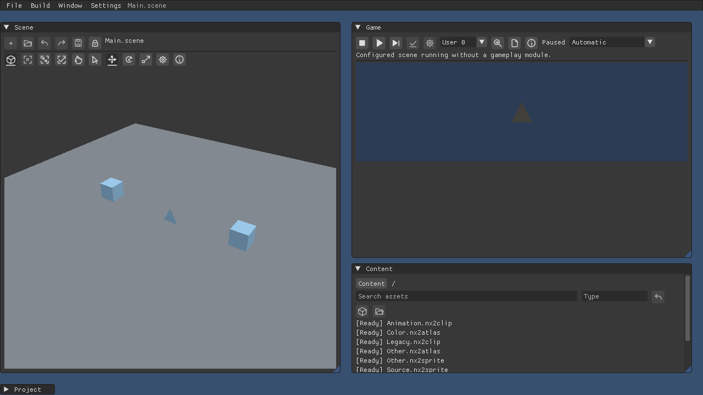
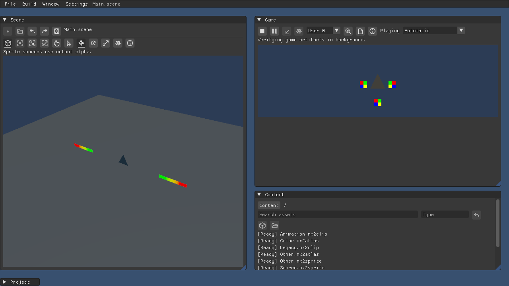
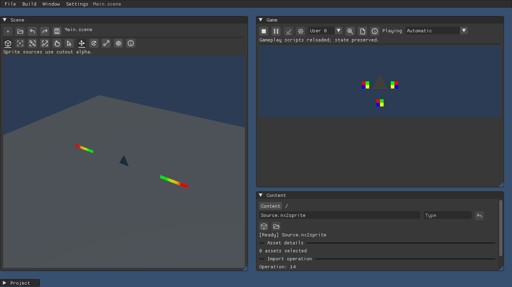

# Interleaved source publication and SDK replacement — supporting Linux qualification

Supporting task `nexora-whr.8.3.9` starts from accepted ED-WF-07 main
`21be880c49d53f25cde4d0ea69062c714af91382`. The final eleven-source tree
`3866198ac42f48b3205d29ba8b00d6befb6ba0ad` passes complete Linux **562/562 in 7170.52 s**,
zero failures/skips/retries. Configure/build also pass. Final-head review and own-PR merge remain
required. This supports ED-WF-08; it does not accept its parent 8.3, standalone Player reload,
independent 8.2/ED-WF-05 or physical/clean-host gates. Workflow **6/9**, graphical Editor **0/8**
and TwoD **9/11** remain unchanged. Root README and manual-only routine CI policy are unchanged.

## Actual native scenario

The new `editor.linux_packaged_source_interleaved` case uses one real configured Game session,
canonical SDK compilation, actual Content Reimport and independent source/pool/central-3D pixels.
For four replacements it waits for real compiler progress, publishes Atlas/Sprite-source variants
while admission is pending, and observes continued old-module Update dispatch. The first new-module
tick must exceed the last old tick observed after publication. Scene/entity/pool identities,
fractional animation time and pool handles remain conserved.

A hidden-pool candidate requesting 999 is rejected while an Atlas is corrupt. The old module and
last-good pixels remain live. A valid code6 replacement recovers while a missing Sprite source is
restored. The final proof has **five successful replacements, thirteen publications, two negative
imports, one candidate rejection and six observed library finalizers (codes 0–5)**. All five original
scene/animation phases and normal Stop/Destroy remain. No forced compiler pause, fake candidate,
input-action retry, relaxed runtime deadline or new product-admission hook is used.

The shared receipt reads the actual copied native publication count; its top-level count must equal
the independently counted interleaved count 13. The first-dispatch/minimum-old tick pairs are
`1:714>160`, `2:1427>880`, `3:2083>1584`, `4:2895>2224`, `6:4328>3952`.

## Results from the same immutable complete gate

| Case | Result | Seconds |
| --- | --- | --- |
| Interleaved source/SDK update | Five replacements / thirteen publications | 305.98 |
| Existing SDK reload | 33 replacements / seven rejects, cancellation and discard guards | 1948.66 |
| Existing source reimport | 70 publications, negative retention, Build and reopen | 395.41 |
| Original Plugin Manager | Native writer/read-only flows, unchanged shortcut producer | 40.87 |
| Modifier regression | 128 scenarios, plain-key/focus/text guards | 65.75 |
| Scene/Project widgets | Actual 1x/2x,150-unit docks, read-only/root/identity/navigation guards | 15.48 |
| Authored preview | 32 cycles,98 GUI requests,196 physical key edges | 65.15 |
| Original pointer release | Unchanged strict pose/pixel assertions and timing | 7.23 |
| Cooked native Player | 900 UI/draw/acquired/presented,0 recoverable, final backend result 0 | 9.91 |

Player diagnostics expose existing surface counters. Every acquired/UI/draw frame reconciles with
successful plus recoverable presentations; only successful presentations count as native frames.
The Linux Vulkan case also requires successful resize recovery to 800×600, existing movement,
Save/Open, audio and balanced ownership. Production presentation scheduling is unchanged.

The preview fixture acknowledges exactly one physical key press and GUI request within the original
eight-second runtime deadline, drains both output streams, and retains failed projects/input/logs.
It preserves all 32-cycle independent pixel/source, pause/step/restart, output-budget and Vulkan checks.
Its historical F5 failure cause remains unproven. The original pointer failure cause also remains
unproven; its later unchanged case passes do not constitute a repaired-case claim.

The confirmed modifier-batching product defect and its native red/green evidence are documented in
[Modifier input](Modifier-Chord-Linux.md). Compact Project controls have distinct actual-widget/native
proof in [Project browser](Project-Toolbar-Linux.md). All three scopes share the final complete gate.

## Preserved earlier attempts

| Checkpoint | Full result | Limitation |
| --- | --- | --- |
| Before late-counter strengthening | Interrupted after 54 cases, exit130 | Not a complete qualification |
| Before receipt correction | 561/561,6562.32 s | Incorrect top-level count70; actual count 13 |
| Receipt corrected | 560/561,6329.09 s | Cooked Player presentation-count failure |
| Five inputs | 559/561,6654.86 s | Original pointer and preview failures |
| Six inputs | 560/561,7133.51 s | Original Plugin Manager chord failure |

The six-input terminal archive retains 20 log/manifest hashes and 314 artifact hashes before runtime
or Project changes. Diagnostic tracing supplies causal evidence only. The original Plugin Manager
physical gesture and 12/120-second operation/whole-case limits remain byte-identical. The current
runtime fix preserves press-time modifiers; it does not mask a product defect by holding producer
keys longer. All old failures, raw traces, source snapshots and candidate proposals remain retained.

## Fresh raw captures and provenance

The [structured receipt](ED-WF-08-Interleaved-Linux.json) records all 562 results, eleven source hashes,
runner/log hashes, fresh SDK/source/Player/preview proofs and current native capture hashes.
The PNGs below are copied unchanged from this final complete gate, without editing or compositing.

Raw runs remain under `/workspace/work/editor-interleaved-source-updates/`. Execution is Linux
Xvfb/software Vulkan; other operating-system, physical-device and clean-host acceptance stays scoped
separately. Final publication still requires exact source/base/head/tree, review and merge guards.
