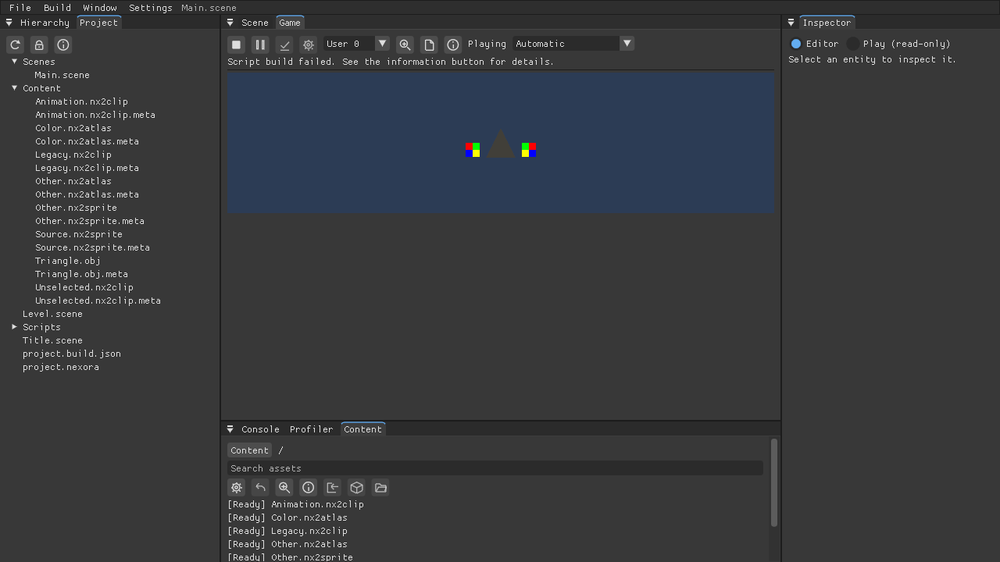
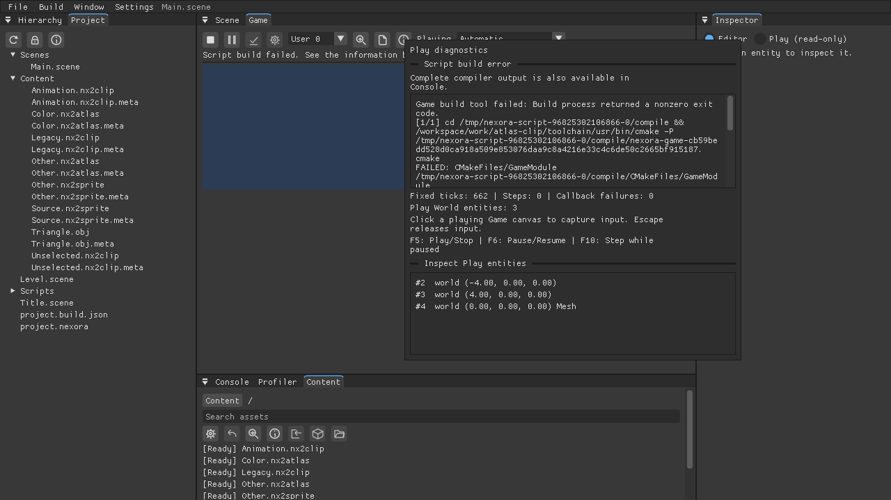
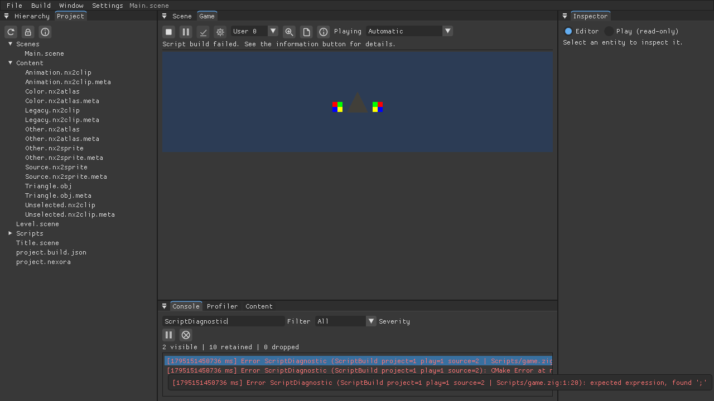

# ✅ Game compiler failure presentation — Linux qualification

Supporting task `nexora-nqn.33` simplifies the existing saved ScriptProject tool-failure status
at rendering time. The Game canvas keeps a concise visible error; its existing information action
opens the complete retained status in an eight-line scrolling area within Play diagnostics.
Console structured errors and original sanitized output remain available. No worker, watcher,
reload/admission, authoring, command or module outcome changes are introduced.

Actual narrow 240-unit Game docks at 1x/2x pass input capture, opening full compiler details,
release of captured Game input, Escape dismissal and retained compact layout. An 8 KiB transcript
with an independent final compiler location stays complete in diagnostics without taking canvas
height. Existing Play/Pause/Step/Stop, disabled running-library edits and other visible errors remain
covered. The focused widget test passes **1/1 in 2.17s**.

Real read-only saved ScriptProject acceptance uses acknowledged physical F5 Play/Stop and the
canonical SDK compiler with an intentionally invalid Zig file. The native pointer opens the actual
observed information control, observes the diagnostics popup and dismisses it with Escape. Captures
below were inspected. Runtime Console retains the located Error `Scripts/game.zig:1:20` and original
sanitized Info output; all 23 authored hashes remain unchanged and Editor closes zero without Vulkan
validation errors. No helper injects compiler output, a Console record or gameplay state.







The complete Linux configure/build/unfiltered CTest gate passes **566/566 in 6567.74s**,
zero failures/skips/retries. Final-head review and own
guarded merge follow qualification. Whole graphical, workflow and physical-platform milestones
remain separate. [Machine-readable evidence](Game-Error-Linux.json).

```bash
python3 Tests/EditorImGui/LinuxScriptConsoleDiagnostics.py \
  --editor build/linux-development/Apps/Editor/NexoraEditor \
  --fixture build/linux-development/Tests/Editor/NexoraGameSpriteBuildTests \
  --xvfb /workspace/work/atlas-clip/toolchain/usr/bin/Xvfb \
  --xdotool /workspace/work/atlas-clip/toolchain/usr/bin/xdotool \
  --evidence-dir /workspace/work/editor-game-error-summary/native \
  --capture --capture-game-status
```
