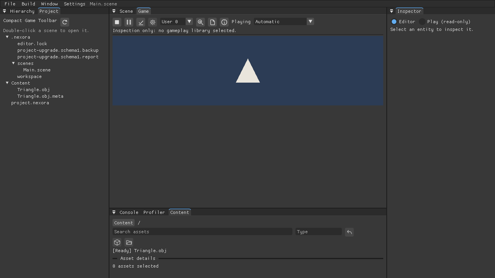
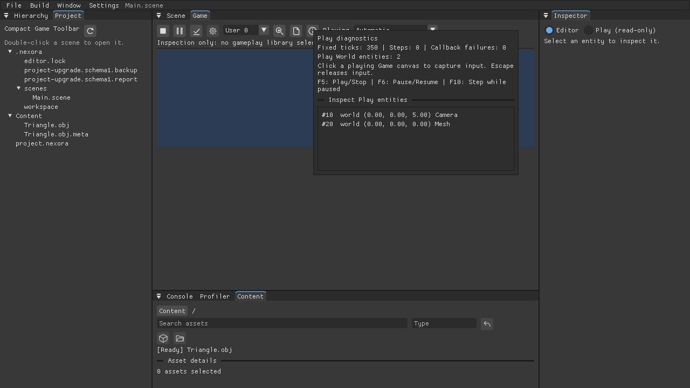

# Compact Game toolbar — Linux acceptance

Game uses wrapping playback/input/view controls and compact session state. The information icon
highlights captured input without resizing the toolbar. Detailed counters, input help and copied
Play entity selection open in its contextual popup; the file icon opens the optional library
field, disabled during Play. Host memory keeps its existing independent read-only window.
Module/input status and rendering failures remain visible. Native 3D/2D rendering bounds and
Runtime ownership are unchanged. See [controls](../../../../Apps/Editor/README.md#compact-game-controls)
and the [presentation contract](../../../../Engine/EditorImGui/README.md#compact-game-presentation).

## Widget regression

The original header fails the new real-widget compact-height assertion (1.66 s). The final
existing Game View test exercises actual 1x/2x clicks, capture release, diagnostics/entity
selection, Play/Pause/Resume/Step/Stop command emission, stopped-only library text input,
240-unit floating-panel bounds, visible error feedback and unchanged Editor World serialization.
An input-capture status check also retains the canvas position. The widget test explicitly links
the existing shared ImGui target and delivers native focus/text/button phases.

The seven related cases pass **7/7 in 16.56 s**: native Scene tools, Game View, host memory,
concurrent Game View, camera selection, input bindings and 2D Game preview. The root README and
5/9 workflow, 0/8 graphical Editor and 9/11 2D milestone totals remain unchanged.

## Native rendering and complete gate

The first native capture completed 92 presented frames and clean Play/Stop/close with unchanged
Scene bytes. A subsequent actual diagnostics capture exposed the legacy native Game direct draw
covering popup text. Its retained image is not accepted as correct popup rendering. A new native
pixel regression independently selects source-positive samples inside the actual popup bounds;
its original-path invocation fails in **6.26 s** with native content overwriting diagnostics.
First-use hidden 16x16 popup geometry is excluded from readiness. The repair uses existing typed
Scene image composition before GUI completion rather than a direct draw after the UI pass.

The repaired native case passes in **6.47 s**, including occlusion/restoration over **218 source
samples**, and the extended Game View case passes at both DPI scales in **4.69 s**. After dismissing
the popup, the native fixture parks the pointer outside toolbar hover before the unchanged paused
pixel-stability oracle. A follow-up native capture completes **190 acquired/presented frames**,
176 Scene draws, 562 Play ticks, zero rejected UI and clean Play/Stop/close with unchanged Scene
bytes (`38357218068ac68925380911e254cec1e9e7bb83a7c68c7d4c6908a46b9d9579`).

The ordinary-Game candidate's Linux configure/build passed. Its affected native/widget group passed **8/8 in
241.77 s**: Game View widgets, 32-cycle Play soak (101.22 s), native Game/popup pixels, materials,
concurrent Scene/Game, mesh assets, debug lines and native 2D (80.67 s). Review identified the same direct-draw issue in pure 3D packaged Play. That owner now also
composes the Game image before ending/submitting UI. Candidate World publication requires UI
success even with empty geometry, and an ended UI frame cannot be replayed for retained content.
The new camera-only rejection/retention unit passes; the existing native packaged A/B/A and
graphical SDK build case passes in **56.97 s**. Sprite composition retains its existing owner.

The earlier unfiltered invocation was deliberately interrupted after 230 passing cases for the
pure 3D packaged repair; it is not a complete gate. Fresh configure/build passed on the final
runtime/widget sources. The replacement unfiltered serial one-worker invocation executed all
**558 cases in 4803.17 s: 552 passed, six failed**. Retained failures are:

- `showcase.linux_vulkan_interaction`: styled-image restoration missed the five-second pixel deadline.
- `editor.linux_plugin_manager`: Packages tab was absent after the fixture restarted the Editor.
- `editor.linux_packaged_sprites`: fixed Inspector coordinates missed the now-higher Game canvas.
- `editor.linux_packaged_source_reload`: candidate compilation missed an existing 90-second wait.
- `editor.linux_packaged_source_reimport`: Editor window did not appear within the existing wait.
- `editor.linux_scene_sprites`: the fixture did not observe F5 release before its deadline.

The packaged Sprite fixture now derives Inspector placement and its collapse click from the
observed Game viewport. Its full source-mask occlusion/restoration assertions and deadlines are
unchanged. The final receipt includes this ninth source; production code remains frozen.
All six cases subsequently passed with their original oracles and deadlines:

| Case | Successful serial recovery |
| --- | --- |
| Packaged Sprite occlusion | 62.10 s, viewport-derived fixture placement |
| Source reimport | 509.55 s, all 70 publications, build and reopen |
| Scene Sprite | 163.79 s |
| Showcase interaction | 132.80 s |
| Plugin manager | 36.08 s |
| Source reload | 1710.78 s, 33 native replacements, rejection/finalizer/Stop cancellation checks |

The first six-case recovery used `LP_NUM_THREADS=1` and took 809.33 s; three passed. Showcase
and plugin management still failed, while source reload encountered `X_GetImage BadMatch`.
Only the verified orphaned compiler/Editor from failed fixtures were stopped. The remaining
three cases passed **3/3 in 1879.69 s** with `LP_NUM_THREADS=2`, still serial. No Showcase/plugin/
reload/reimport/Scene-Sprite source or oracle was changed. The complete invocation plus these
successful recoveries covers every registered case; the original complete invocation is not
reported as a single clean 558/558 run.

Upstream main commits through `aeb38aea` changed only workflow triggers and AGENTS.md. They
were fast-forwarded before publication with all nine runtime/test hashes unchanged. The latest
manual-only routine CI policy is preserved; no workflow is dispatched for this routine PR.
Root README and milestone totals remain unchanged. Linux software-Vulkan evidence does not
certify physical/clean-host display, GPU, DPI or device acceptance.
