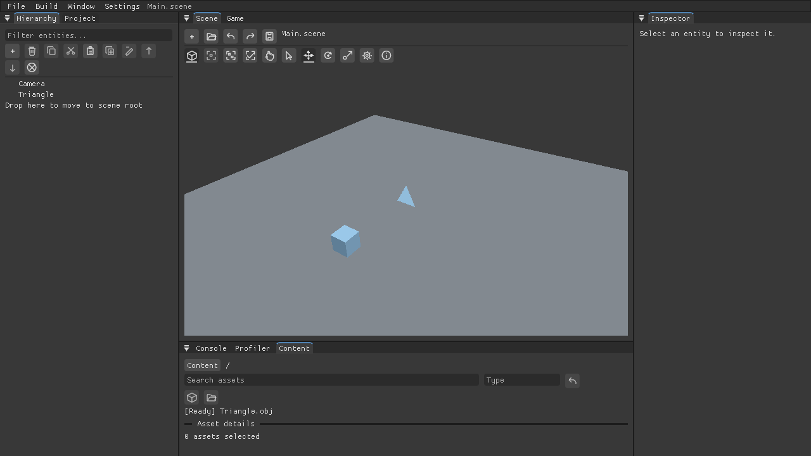
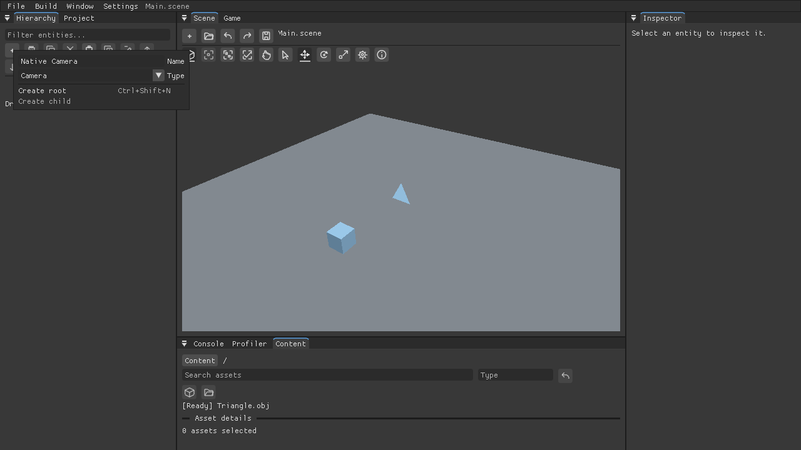
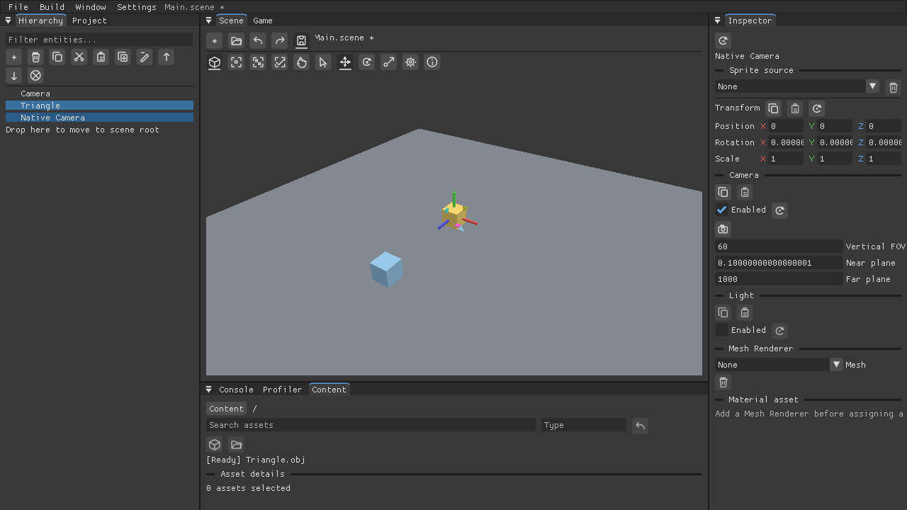

# Compact Hierarchy controls — Linux acceptance

The Hierarchy filter and wrapping icon toolbar retain the entity tree's editing space. The plus
icon opens name/type/root/child creation on demand. Delete, clipboard, duplicate, rename, sibling
movement and clear-selection actions remain reachable. Routine operation results appear in action
tooltips; actionable errors remain above the tree. See [controls](../../../../Apps/Editor/README.md#compact-hierarchy-controls)
and [presentation contract](../../../../Engine/EditorImGui/README.md#compact-hierarchy-presentation).

## Real widget interaction

The old header fails the new permanent-creation-row assertion in **1.57 s**. The expanded existing
`editor.builtin_creation_input` passes at 1x/2x scale, including a **150 logical-unit** floating
panel containing all ten action controls. It exercises actual popup/name/type/root/child input,
custom/default names, component initialization, root keyboard creation, exact complete Undo/Redo,
save/reload, stale document/parent rejection and read-only/modal admission. Clipboard errors remain
visible and consume space; Copy confirmation and its shortcut appear in contextual feedback without
permanent tree rows. Duplicate, Cut/Paste and Delete restore exact Scene bytes through Undo.

The widget case passes in **23.89 s**. The related group passes **11/11 in 89.22 s**, including the
same case (19.40 s), built-in model contract, Hierarchy snapshot index, full ImGui contract, Scene
tools, Game View, select-all, keyboard Rename, Scene file input, keyboard navigation and hidden
Hierarchy request handling. Popup/tooltip drawing preserves the owning toolbar item for wrapping.
The existing shared ImGui target is explicitly linked by this widget test; no runtime dependency
or stable C/Zig API changes.

## Actual native Editor

An actual Linux Xvfb/software-Vulkan Editor was inspected at 1280x720. Native mouse/text input
opened Create entity, authored **Native Camera**, selected Camera, and created a root. Its Inspector
shows identity local TRS, vertical FOV60, near0.1 and far1000. One processed Ctrl+Z removed it;
normal close returned0 with two original scene nodes. The Editor acquired/presented **4402 frames**,
recorded **4401 Scene draws** and rejected **zero UI submissions**. The committed fixture Scene
remained byte-identical (`6edc8adc2cf767b7197b7739edf5852c14f7f1250731d6183ce87ea2058dfd1d`).
These are raw native captures, not mockups or image edits.

## Complete gate

Fresh `cmake --preset linux-development` and `cmake --build --preset linux-development` pass.
The unfiltered `LP_NUM_THREADS=2 CTEST_PARALLEL_LEVEL=1 ctest --preset linux-development
--output-on-failure` passes **558/558 in 6281.43 s**, with zero failures/skips/retries. The final
four runtime/test/CMake hashes remain identical to the frozen pre-gate receipt.

The complete invocation includes the expanded creation input case (17.79 s), 100,000-node
Hierarchy lifecycle/scale (225.70 s), native source reload (1798.27 s, 33 actual replacements plus
rejection/finalizer/Stop cancellation checks), and source reimport (401.89 s, 70 publications,
rebuild and reopen). The original old-header red-widget result is retained separately. Final source hashes remain
unchanged; no deadline was relaxed. The root README and milestone totals remain unchanged:
workflow5/9, graphical Editor0/8, TwoD9/11. This scoped Linux software-Vulkan evidence does not
accept physical-display/GPU, installed IME, per-monitor DPI or cross-platform target workflows.
Routine CI remains manual under the current AGENTS.md policy.
