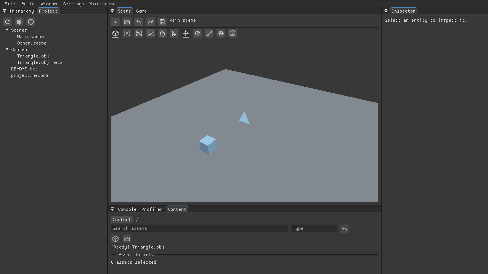
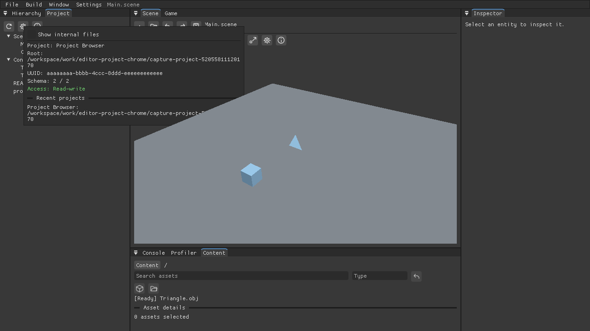
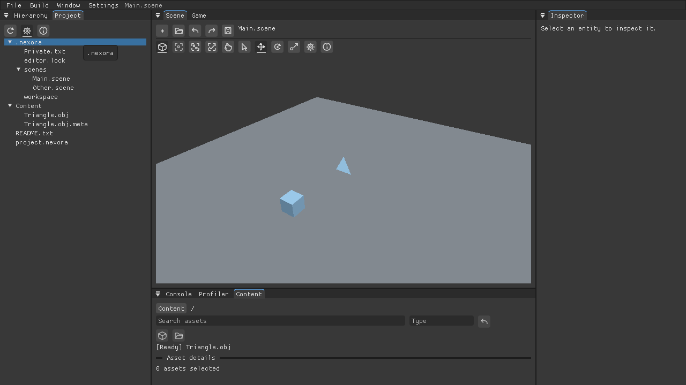
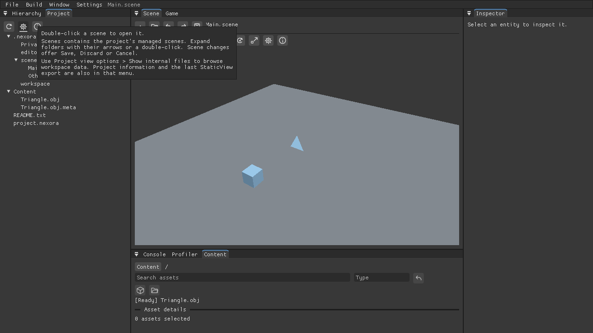
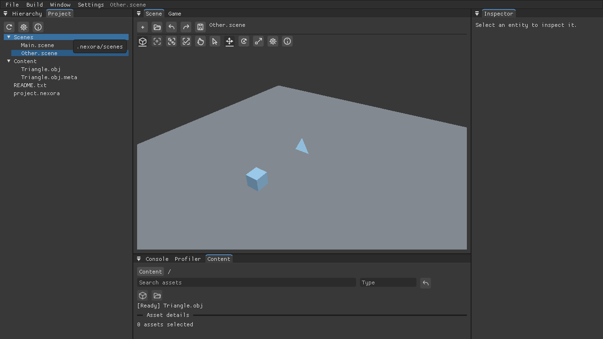

# ✅ Compact Project browser — Linux qualification

The Project browser uses a wrapping Refresh/View/Help icon toolbar with named tooltips and the
existing Ctrl+R shortcut. Normal browsing exposes managed scenes as **Scenes**; **Show internal
files** reveals the complete tree. Project identity, access, recent projects and routine export
results are available on demand. Actionable errors, required upgrades and active exports stay visible.
This is presentation state: paths, source bytes, writer permission and scene command ownership remain
unchanged. Public file identities include the real project root and path in both views.

The final eleven-source Linux gate passes **562/562 in 7170.52 s**, zero failures/skips/retries,
after configure/build. Its changed `editor.scene_file_input` case passes **15.48 s**, including
actual 1x/2x interaction,150-unit docks, read-only view/refresh behavior, stable identities,
stale-project isolation and existing Save/Discard/Cancel navigation. Earlier focused 15.88 s
observations remain historical. Final-head review and own-PR merge are still required.

The actual 1280×720 Vulkan Editor opens Project through its public focus shortcut, displays both
views and their settings/help, and double-clicks the emitted coordinates of the real
`.nexora/scenes/Other.scene` row. Startup metadata acknowledges that exact path. Native close returns
zero; all eight authored source hashes remain unchanged. An earlier capture clicked the wrong row
after switching views and is retained as a non-acceptance attempt. See the
[structured receipt](Project-Toolbar-Linux.json).

Workflow **6/9**, complete graphical Editor **0/8** and TwoD **9/11** remain unchanged.
