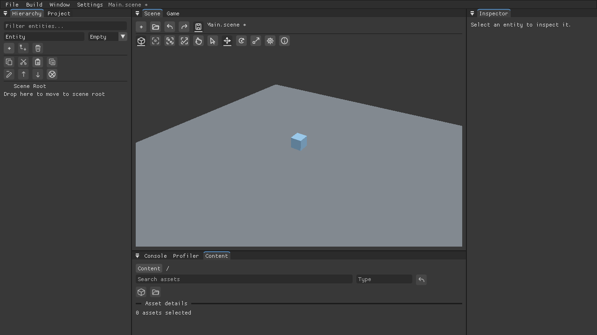

# Compact Scene toolbar — Linux acceptance

Scene now reserves its canvas for editing: document actions and the scene name share a compact
row; view/framing/transform actions form a wrapping icon toolbar. Axes/pivot/snap settings and
navigation help open on demand. Dirty filenames use `*`; Save remains highlighted when a narrow
panel truncates the name. Its tooltip shows current state before last-action feedback. Errors
remain visible and wrapped; a lock icon explains read-only access. Existing commands, shortcuts,
focus/modal ownership, permissions and gesture cancellation remain in place.

The shared standard is recorded in [AGENTS.md](../../../../AGENTS.md#editor-interface-conventions),
[CLAUDE.md](../../../../CLAUDE.md#editor-介面規範), [Editor controls](../../../../Apps/Editor/README.md#editor-interface-standard)
and the EditorImGui contract, with synchronized EN/ZH roadmap references. This supports existing
native 3D and X/Z overview modes; Editor/workflow milestone totals remain unchanged.

This is an unmodified native X11/Xvfb software-Vulkan capture. The final capture also exercised
actual Ctrl+S publication followed by a clean native close: 205 acquired/presented frames,
`ui_rejected=0`, read-write access. Physical/clean-host acceptance remains separate.

## Retained baseline and repairs

The first unfiltered 558-case invocation completed with **555 passes, three failures, zero
skips, 7051.16 s**. This is not labeled an all-green invocation. The failures were:

- The unchanged 100k-node Hierarchy lifecycle exceeded its 300 s aggregate limit. Its isolated
  repeat passed under the original limit in **228.18 s**; no production cause is established.
- Play soak froze an initial colored Game readback before presentation had settled. A diagnostic
  showed the reference hash changing from `b3352d02492dd0f2…` to `3423edce268c71e9…` **before any
  input**, then remaining at the latter hash after uncaptured input, with neutral fixed updates.
  Startup now requires 0.3 s of stable visible pixels inside the original three-second readiness
  bound; every subsequent exact pixel/input/lifecycle/RSS oracle remains unchanged. The actual
  32-cycle case passes in **96.48 s**.
- The Sprite occluder still used the old fixed `(240,400)` position, while its projected texel
  moved to `(258,291)`. Placement now derives from the independent projection and explicitly
  checks that the probe lies inside the Inspector body. Two subsequent 180 s timeouts reached
  late reimport generations: complete readback grew with the larger canvas. The canonical packed
  BGRX8 reader now converts every RGB byte in bulk, with the original reader retained for other
  layouts. The first eligible snapshot is compared byte-for-byte with XGetPixel on the **same
  frozen XImage** (`604x532` verified). The full native case passes in **123.05 s**, retaining all
  32 Play/reimport cycles, opacity/pick/occlusion/resize, identity and last-good checks.

The baseline independently passed canonical native reload (**2300.38 s**, 33 actual replacements,
seven rejected candidates) and reimport (**427.82 s**, 32 cycles/70 publications and saved reopen).

## Final UI regression

Actual 1x/2x widget interaction covers settings/help, view switching, narrow 240-unit tool bounds,
routine-feedback height stability and persistent errors, plus the pre-existing input/history
contracts. A narrow Save hover is also exercised with actual rendered tooltip text. Reflow was
not reproduced with the vendored ImGui, which already restores parent item data; the regression
instead exposed stale success feedback masking current dirty state (**red 2.48 s**). Current state
and historical feedback are now separate, one dirty-signature observation feeds the header, and
button metadata is explicitly preserved. The final case passes at both DPI scales (**2.49 s**).

## Final complete gate

The final six C++/Python sources are frozen in the task receipt. Fresh mandatory Linux
configure/build passed. The final unfiltered complete invocation finished in **6182.86 s**:
**551/558 passed**, seven failures, zero skips, serial with two software-Vulkan workers.
Failures were animation Build picker (compile wait), Hierarchy lifecycle (300 s timeout), Scene
merge publication (pointer phase), native center (ring visibility), native meshes (45 s timeout),
packaged source services (key release timeout) and canonical reload (generation-two admission).
Original logs are retained. A serial one-worker isolated recovery is pending; these failures are
not labeled resolved, and merge remains gated on local validation plus exact-head CI/review.
Root README stays unchanged.
