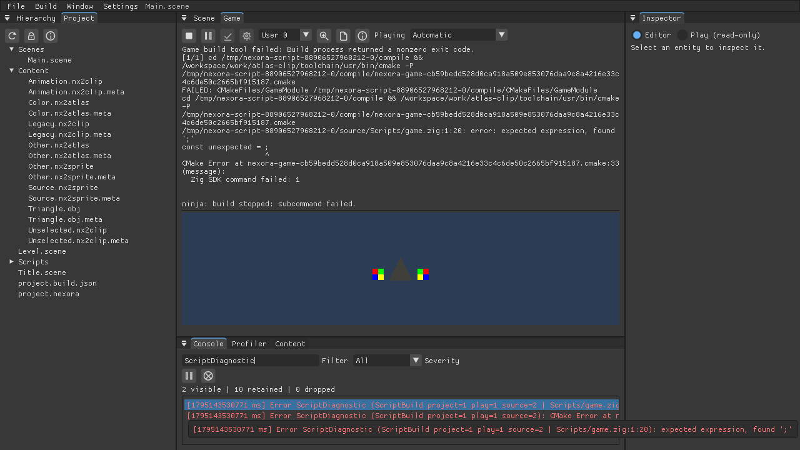

# ✅ SDK ScriptProject Console diagnostics — Linux qualification

The complete Linux configure/build/unfiltered CTest gate passes **566/566 in 6098.03s**,
zero failures/skips/retries. This supporting slice is
`nexora-gu7.14.2`; parent M3-06, claimed ED-WF05/08 and whole Editor/privacy/platform acceptance
remain separate. [Receipt](Script-Console-Linux.json) records nine frozen inputs, including the
unchanged compiler/watcher/producer contracts. No module graph, public ABI, production linkage
boundary or routine CI trigger changes; other platforms/physical desktop acceptance are not claimed.

The private native owner consumes existing current-key `GameBuildProgress` diagnostics into
owning `ScriptDiagnostic` Console rows with severity and optional reported file/line/column.
Current project/Play/source labels are taken after source observation; compiler request filtering,
watcher scheduling, source/artifact/reload admission and the existing sanitized Info route stay
unchanged. No raw-byte parser, file navigation or new worker callback is introduced.

Up to32 diagnostic file/message fields of1024 UTF-8 bytes are inspected. Successful calls retain
only the current unique snapshot (at most32); failed publication can retain at most64 committed
identities for same-observation retry. Truncation flags produce bounded Warning feedback with
unknown byte/record loss counts; valid known source-budget suppression uses actual record units.
Malformed data and stale/foreign scopes preserve history. Console rejection consumes each identity once.

Focused compatibility passes **5/5 in26.03s**, including the existing native Build Console argv/
run/cancel/fail/zero-exit case and the previous real local-compiler diagnostic test. Final adapter
bounds/optional-location tests pass **1/1 in0.03s**. Cases cover the real producer sanitizer,
Note/Warning/Error, UTF-8/Windows/unlocated/partial locations, duplicates and reordered rolling
snapshots, source/Play/project transitions, explicit unknown truncation, exact source/message
budgets, malformed data and disabled Console admission.

Actual native Xvfb/Vulkan acceptance starts saved ScriptProject Play with an acknowledged physical
F5, using real read-only fixture sources with an intentionally invalid Zig file. The canonical SDK
compiler reports `Scripts/game.zig:1:20` / `expected expression, found ';'`. Runtime Console owns
that Error plus an unlocated CMake Error under `project=1 play=1 source=2`; original sanitized
`Script Build` Info records remain. Compilation is rejected (`applied=0 generation=0`), Play Stop
is acknowledged, Editor closes0 with no Vulkan validation errors, and all23 authored input SHA256
remain unchanged. No helper injects a compiler result, Console record or gameplay state.

The accepted capture phases actual native text input and waits for two visible Console rows;
its tooltip shows the complete reported location/message. The first functional cohort passed,
but its earlier screenshot still showed an incomplete filter and is retained externally as progress.
The test-only observer is explicitly environment gated and reads existing Console state only.



```bash
python3 Tests/EditorImGui/LinuxScriptConsoleDiagnostics.py \
  --editor build/linux-development/Apps/Editor/NexoraEditor \
  --fixture build/linux-development/Tests/Editor/NexoraGameSpriteBuildTests \
  --xvfb /workspace/work/atlas-clip/toolchain/usr/bin/Xvfb \
  --xdotool /workspace/work/atlas-clip/toolchain/usr/bin/xdotool \
  --evidence-dir /workspace/work/editor-script-console-diagnostics/native-capture --capture
```
